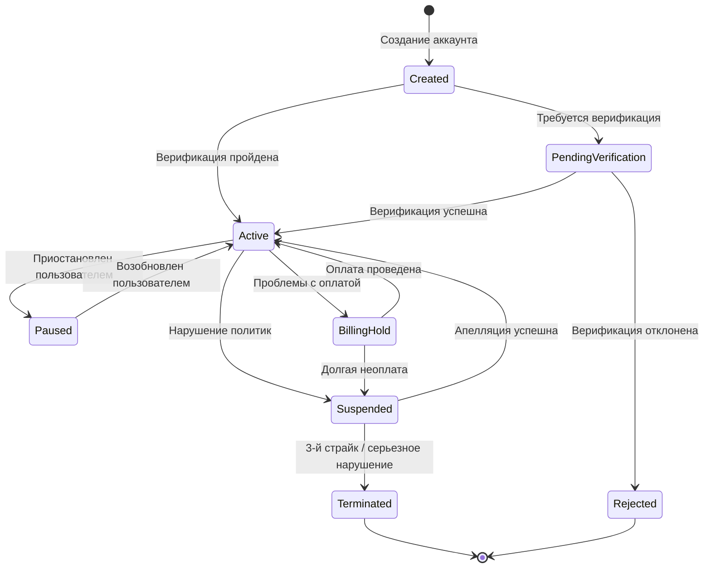

# Google Ads - Структура аккаунта (Account Structure)

> **Module ID**: GADS-ACCT
> **Version**: 1.0.0
> **Last Updated**: 2025-01-08
> **Status**: Production Reference

## Общее описание модуля

Модуль "Структура аккаунта" определяет иерархическую организацию аккаунтов в Google Ads, включая управляющие аккаунты (MCC - My Client Center), клиентские аккаунты, связи между ними, роли доступа и права пользователей. Данный модуль является фундаментальным для управления рекламными кампаниями агентств, крупных рекламодателей и корпоративных структур.

## Характеристики модуля

| Характеристика | Значение |
|----------------|----------|
| Тип модуля | Организационная структура |
| Максимальная глубина иерархии | 6 уровней |
| Максимум управляющих аккаунтов | 5 уровней |
| Лимит аккаунтов под одним MCC | 85,000 |
| Лимит MCC для клиентского аккаунта | До 5 управляющих аккаунтов |
| Срок действия приглашения | 30 дней |

---

## 1. Типы аккаунтов

### 1.1 Стандартный аккаунт Google Ads (Individual Account)

**Описание**: Базовая единица в системе Google Ads, предназначенная для непосредственного управления рекламными кампаниями.

**Характеристики:**
- Содержит кампании, группы объявлений, объявления и ключевые слова
- Имеет собственный профиль оплаты (Payments Profile)
- Может быть связан с несколькими управляющими аккаунтами (до 5)
- Не может управлять другими аккаунтами

**Ограничения:**
- Один аккаунт = один рекламодатель (юридическое или физическое лицо)
- Нельзя связать с более чем одним MCC в одной иерархии
- Обязательно наличие минимум одного пользователя с Admin-доступом

### 1.2 Управляющий аккаунт (Manager Account / MCC)

**Описание**: Аккаунт верхнего уровня для централизованного управления множеством клиентских аккаунтов или других управляющих аккаунтов.

**Характеристики:**
- Не содержит собственных рекламных кампаний
- Управляет связанными клиентскими и суб-управляющими аккаунтами
- Предоставляет единый интерфейс для мониторинга и отчетности
- Может быть владельцем (Owner) клиентских аккаунтов
- Поддерживает консолидированный биллинг

**Типы MCC по назначению:**

| Тип | Описание | Типичное использование |
|-----|----------|------------------------|
| Агентский MCC | Для рекламных агентств | Управление аккаунтами клиентов агентства |
| Корпоративный MCC | Для крупных компаний | Управление аккаунтами подразделений/брендов |
| Реселлерский MCC | Для партнеров Google | Перепродажа рекламных услуг |
| Суб-менеджер | Вложенный MCC | Делегирование управления регионам/командам |

---

## 2. Иерархия аккаунтов

### 2.1 Структура иерархии

```
[Корневой MCC] (Уровень 1)
    |
    +-- [Суб-MCC: Регион А] (Уровень 2)
    |       |
    |       +-- [Суб-MCC: Страна 1] (Уровень 3)
    |       |       |
    |       |       +-- [Клиентский аккаунт 1]
    |       |       +-- [Клиентский аккаунт 2]
    |       |
    |       +-- [Клиентский аккаунт 3]
    |
    +-- [Суб-MCC: Регион Б] (Уровень 2)
    |       |
    |       +-- [Клиентский аккаунт 4]
    |
    +-- [Клиентский аккаунт 5] (напрямую связан)
```

### 2.2 Правила иерархии

| Правило | Описание |
|---------|----------|
| BR-ACCT-001 | Максимальная глубина структуры - 6 уровней |
| BR-ACCT-002 | Максимум 5 уровней управляющих аккаунтов друг над другом |
| BR-ACCT-003 | Клиентский аккаунт не может быть связан с двумя MCC в одной иерархии |
| BR-ACCT-004 | Клиентский аккаунт может быть связан максимум с 5 разными MCC |
| BR-ACCT-005 | Один MCC может управлять до 85,000 аккаунтов |
| BR-ACCT-006 | Новый MCC без расходов имеет лимит 50 активных аккаунтов по умолчанию |

### 2.3 Карта аккаунтов (Account Map)

**Функциональность:**
- Визуализация всей структуры аккаунтов под управляющим аккаунтом
- Отображение метрик эффективности на уровне аккаунтов
- Группировка аккаунтов по метками (labels)
- Навигация по иерархии

**Метрики, доступные на карте:**
- Клики
- Показы
- Расходы
- Конверсии
- CTR, CPC, CPA

---

## 3. Уровни доступа и роли

### 3.1 Уровни доступа

| Уровень | ID | Описание | Приоритет |
|---------|-----|----------|-----------|
| Admin (Администратор) | ACCESS_ADMIN | Полный контроль над аккаунтом | Высший |
| Standard (Стандартный) | ACCESS_STANDARD | Управление кампаниями без административных функций | Высокий |
| Read-only (Только чтение) | ACCESS_READONLY | Просмотр данных без возможности изменений | Средний |
| Billing (Биллинг) | ACCESS_BILLING | Управление только платежной информацией | Средний |
| Email-only (Только email) | ACCESS_EMAIL | Получение уведомлений без доступа к интерфейсу | Низший |

### 3.2 Матрица разрешений

| Действие | Admin | Standard | Read-only | Billing | Email-only |
|----------|:-----:|:--------:|:---------:|:-------:|:----------:|
| Просмотр отчетов и статистики | + | + | + | - | - |
| Создание/редактирование кампаний | + | + | - | - | - |
| Изменение настроек аккаунта | + | + | - | - | - |
| Создание конверсий из GA4 | + | + | - | - | - |
| Управление пользователями | + | - | - | - | - |
| Изменение уровней доступа | + | - | - | - | - |
| Привязка/отвязка менеджеров | + | - | - | - | - |
| Связывание продуктов (GA, GMC) | + | - | - | - | - |
| Просмотр платежной информации | + | - | - | + | - |
| Изменение платежных методов | + | - | - | + | - |
| Верификация рекламодателя | + | - | - | - | - |
| Получение email-уведомлений | + | + | + | + | + |

### 3.3 Правила назначения доступа

| Правило | Описание |
|---------|----------|
| BR-ACCESS-001 | Пользователь может выдать доступ только равный или ниже своего уровня |
| BR-ACCESS-002 | В аккаунте должен быть минимум один пользователь с Admin-доступом |
| BR-ACCESS-003 | Рекомендуется иметь минимум двух администраторов |
| BR-ACCESS-004 | Доступ на уровне MCC распространяется на все дочерние аккаунты |
| BR-ACCESS-005 | Нельзя настроить разные уровни доступа для разных аккаунтов внутри одного MCC |

---

## 4. Владение аккаунтом (Ownership)

### 4.1 Концепция владения

**Владелец (Owner)** - это управляющий аккаунт с особыми привилегиями над клиентским аккаунтом.

**Права владельца:**
- Полный административный доступ к клиентскому аккаунту
- Приглашение пользователей с Admin-доступом в клиентский аккаунт
- Включение списков ремаркетинга для шаринга с другими аккаунтами в MCC
- Доступ к персональным данным клиентского аккаунта

**Ограничения:**
- У клиентского аккаунта может быть только один владелец (с 2020 года)
- Владение не лишает клиентский аккаунт собственных прав
- Клиентский аккаунт может отвязаться от владельца в любой момент

### 4.2 Состояния владения

```
[Без владельца] --> [Есть владелец]
       ^                    |
       |                    v
       +---- [Смена владельца]
```

### 4.3 User Stories: Владение

**US-OWN-001**: Как администратор MCC, я хочу установить владение над клиентским аккаунтом, чтобы получить расширенные права управления.

**Критерии приемки:**
- AC-001: MCC должен быть связан с клиентским аккаунтом
- AC-002: У клиентского аккаунта не должно быть другого владельца в этой иерархии
- AC-003: После установки владения появляется метка "Owner" в списке аккаунтов

**US-OWN-002**: Как администратор клиентского аккаунта, я хочу отвязаться от владельца MCC, чтобы восстановить независимость аккаунта.

**Критерии приемки:**
- AC-001: В аккаунте должен быть минимум один собственный пользователь с Admin-доступом
- AC-002: После отвязки все связи с владельцем разрываются
- AC-003: Данные и кампании остаются в аккаунте

**US-OWN-003**: Как администратор MCC-владельца, я хочу передать владение другому MCC, чтобы реорганизовать структуру управления.

**Критерии приемки:**
- AC-001: Новый MCC должен быть связан с клиентским аккаунтом
- AC-002: Старый MCC теряет права владельца
- AC-003: Клиентский аккаунт не прерывает работу

---

## 5. Связывание аккаунтов (Account Linking)

### 5.1 Процесс связывания

```
[MCC отправляет приглашение]
        |
        v
[Приглашение в статусе PENDING]
        |
        +---> [Клиент принимает] --> [Статус ACTIVE] --> [Аккаунты связаны]
        |
        +---> [Клиент отклоняет] --> [Приглашение удалено]
        |
        +---> [30 дней истекло] --> [Приглашение истекло]
```

### 5.2 Состояния связи

| Состояние | ID | Описание |
|-----------|-----|----------|
| Pending | LINK_PENDING | Приглашение отправлено, ожидает принятия |
| Active | LINK_ACTIVE | Связь установлена и активна |
| Inactive | LINK_INACTIVE | Связь приостановлена |
| Cancelled | LINK_CANCELLED | Приглашение отменено отправителем |
| Rejected | LINK_REJECTED | Приглашение отклонено получателем |
| Expired | LINK_EXPIRED | Приглашение истекло (30 дней) |

### 5.3 Правила связывания

| Правило | Описание |
|---------|----------|
| BR-LINK-001 | Связывание инициируется только со стороны MCC |
| BR-LINK-002 | Принятие приглашения требует Admin-доступа в клиентском аккаунте |
| BR-LINK-003 | Приглашение действительно 30 дней |
| BR-LINK-004 | Один аккаунт не может быть связан дважды в одной иерархии |
| BR-LINK-005 | При связывании структура не должна превысить 6 уровней |
| BR-LINK-006 | Приглашение можно принять через email-ссылку |

### 5.4 User Stories: Связывание

**US-LINK-001**: Как администратор MCC, я хочу отправить приглашение на связывание клиентскому аккаунту, чтобы начать управление его рекламой.

**Предусловия:**
- Пользователь имеет Admin-доступ к MCC
- Известен ID клиентского аккаунта (XXX-XXX-XXXX)

**Основной сценарий:**
1. Администратор открывает раздел "Sub-account settings" в MCC
2. Нажимает кнопку "Link existing account"
3. Вводит ID клиентского аккаунта
4. Система проверяет существование аккаунта
5. Система проверяет ограничения иерархии
6. Приглашение создается со статусом PENDING
7. Клиентский аккаунт получает уведомление

**Альтернативные сценарии:**
- 4a. Аккаунт не найден → Отображается ошибка
- 5a. Нарушены ограничения → Отображается ошибка с описанием

**US-LINK-002**: Как администратор клиентского аккаунта, я хочу принять приглашение от MCC, чтобы получить поддержку в управлении рекламой.

**Предусловия:**
- Есть входящее приглашение со статусом PENDING
- Пользователь имеет Admin-доступ к клиентскому аккаунту

**Основной сценарий:**
1. Администратор открывает раздел "Access and security"
2. Переходит на вкладку "Managers"
3. Видит список приглашений в разделе "Link requests"
4. Нажимает "Accept" рядом с нужным приглашением
5. Система устанавливает связь (статус ACTIVE)
6. MCC получает уведомление о принятии
7. Аккаунт появляется в списке суб-аккаунтов MCC

**US-LINK-003**: Как администратор клиентского аккаунта, я хочу отвязаться от MCC, чтобы прекратить внешнее управление.

**Предусловия:**
- Аккаунт связан с MCC
- Пользователь имеет Admin-доступ

**Критерии приемки:**
- AC-001: Связь разрывается мгновенно
- AC-002: MCC теряет доступ к аккаунту
- AC-003: Данные и кампании сохраняются
- AC-004: Если MCC был платящим менеджером, показ рекламы останавливается

---

## 6. Организация аккаунтов

### 6.1 Метки аккаунтов (Account Labels)

**Описание**: Метки позволяют группировать и организовывать клиентские аккаунты в MCC.

**Характеристики:**
- Создаются только на уровне MCC
- Не видны в клиентских аккаунтах
- Поддерживают цветовую маркировку
- Используются для фильтрации и отчетности

**Примеры использования:**

| Метка | Цвет | Описание |
|-------|------|----------|
| VIP-клиенты | Золотой | Ключевые клиенты с высоким бюджетом |
| E-commerce | Синий | Интернет-магазины |
| B2B | Зеленый | Корпоративные клиенты |
| Новые клиенты | Желтый | Клиенты на онбординге |
| Требует внимания | Красный | Аккаунты с проблемами |

### 6.2 Правила для меток

| Правило | Описание |
|---------|----------|
| BR-LABEL-001 | Метки создаются и управляются только в MCC |
| BR-LABEL-002 | Одному аккаунту можно присвоить несколько меток |
| BR-LABEL-003 | Метки не наследуются по иерархии |
| BR-LABEL-004 | Удаление метки не влияет на аккаунты |

### 6.3 User Stories: Метки

**US-LABEL-001**: Как менеджер MCC, я хочу создать систему меток для аккаунтов, чтобы организовать портфель клиентов.

**Критерии приемки:**
- AC-001: Можно создать метку с названием, цветом и описанием
- AC-002: Метка появляется в списке доступных меток
- AC-003: Метку можно применить к нескольким аккаунтам

**US-LABEL-002**: Как менеджер MCC, я хочу фильтровать аккаунты по меткам, чтобы быстро находить нужные группы клиентов.

**Критерии приемки:**
- AC-001: Доступен фильтр по меткам в списке аккаунтов
- AC-002: Можно выбрать несколько меток (OR или AND логика)
- AC-003: Результаты обновляются мгновенно

---

## 7. Биллинг и платежные профили

### 7.1 Структура биллинга

```
[Payments Profile] (Профиль оплаты)
        |
        +-- [Billing Setup 1] --> [Google Ads Account 1]
        |
        +-- [Billing Setup 2] --> [Google Ads Account 2]
        |                     --> [Google Ads Account 3]
        |
        +-- [Billing Setup 3] --> [Google Ads Account 4]
```

### 7.2 Типы биллинга

| Тип | Описание | Требования |
|-----|----------|------------|
| Индивидуальный биллинг | Каждый аккаунт платит отдельно | Стандартный аккаунт |
| Консолидированный биллинг | Один счет на несколько аккаунтов | MCC + ежемесячное выставление счетов |
| Менеджер-плательщик | MCC оплачивает за клиентские аккаунты | MCC с профилем оплаты |

### 7.3 Консолидированный биллинг

**Преимущества:**
- Один ежемесячный счет на все аккаунты
- Упрощенное управление финансами
- Централизованный контроль расходов

**Требования:**
- Наличие управляющего аккаунта (MCC)
- Настройка ежемесячного выставления счетов (Monthly Invoicing)
- Все аккаунты в одном биллинг-сетапе связаны с одним MCC

### 7.4 Правила биллинга

| Правило | Описание |
|---------|----------|
| BR-BILL-001 | Один Payments Profile может иметь несколько Billing Setup |
| BR-BILL-002 | При отвязке от платящего MCC реклама останавливается немедленно |
| BR-BILL-003 | Перенос биллинга возможен только с Admin-доступом |
| BR-BILL-004 | Link-management permission выдается только одному MCC на профиль |

### 7.5 User Stories: Биллинг

**US-BILL-001**: Как финансовый администратор агентства, я хочу настроить консолидированный биллинг, чтобы получать один счет на всех клиентов.

**Предусловия:**
- MCC настроен на ежемесячное выставление счетов
- Клиентские аккаунты связаны с MCC

**Критерии приемки:**
- AC-001: Все выбранные аккаунты включены в один Billing Setup
- AC-002: Ежемесячно формируется консолидированный счет
- AC-003: Можно видеть расходы по каждому аккаунту в счете

**US-BILL-002**: Как администратор клиентского аккаунта, я хочу перенести биллинг при смене агентства, чтобы продолжить показ рекламы.

**Критерии приемки:**
- AC-001: Процесс переноса не прерывает показ рекламы
- AC-002: Новый платежный профиль активируется немедленно
- AC-003: История платежей сохраняется

---

## 8. Перемещение аккаунтов

### 8.1 Сценарии перемещения

| Сценарий | Описание | Возможность |
|----------|----------|-------------|
| Внутри иерархии | Перемещение между суб-менеджерами одного MCC | Да |
| Между иерархиями | Перемещение в другую MCC-структуру | Через отвязку/привязку |
| С биллингом | Перемещение с сохранением платежного профиля | Требует переноса биллинга |

### 8.2 Процесс перемещения внутри иерархии

```
[Клиентский аккаунт под Суб-MCC A]
        |
        v
[Администратор корневого MCC выбирает аккаунт]
        |
        v
[Выбирает целевой Суб-MCC B]
        |
        v
[Система проверяет ограничения]
        |
        v
[Аккаунт перемещен под Суб-MCC B]
```

### 8.3 Правила перемещения

| Правило | Описание |
|---------|----------|
| BR-MOVE-001 | Перемещение возможно только напрямую связанных аккаунтов |
| BR-MOVE-002 | Требуется Admin-доступ к управляющему аккаунту |
| BR-MOVE-003 | Целевой менеджер должен быть в той же иерархии |
| BR-MOVE-004 | Не должны нарушаться ограничения глубины иерархии |
| BR-MOVE-005 | При ежемесячном биллинге может потребоваться смена платящего менеджера |

---

## 9. Приостановка и блокировка

### 9.1 Типы приостановки

| Тип | Причина | Влияние |
|-----|---------|---------|
| Приостановка аккаунта | Нарушение политик | Реклама не показывается |
| Приостановка MCC | Нарушение политик MCC | Все связанные аккаунты могут быть затронуты |
| Приостановка биллинга | Проблемы с оплатой | Реклама не показывается |
| Временная блокировка | 1-й или 2-й страйк | Блокировка на 3-7 дней |
| Полная блокировка | 3-й страйк или серьезное нарушение | Постоянная блокировка |

### 9.2 Система страйков

```
[Первое нарушение] --> [Страйк 1] --> [Блокировка 3 дня]
        |
        v
[Второе нарушение] --> [Страйк 2] --> [Блокировка 7 дней]
        |
        v
[Третье нарушение] --> [Страйк 3] --> [Полная блокировка аккаунта]
```

### 9.3 Влияние блокировки MCC на связанные аккаунты

**Важно**: При блокировке управляющего аккаунта за нарушение политик Google:
- Связанные клиентские аккаунты могут быть приостановлены
- Приостановка действует до отвязки от нарушающего MCC
- Клиентские аккаунты должны отвязаться для восстановления работы

### 9.4 Правила блокировки

| Правило | Описание |
|---------|----------|
| BR-SUSP-001 | Максимум 3 страйка на одну политику |
| BR-SUSP-002 | При блокировке MCC клиентские аккаунты могут работать после отвязки |
| BR-SUSP-003 | Апелляция возможна в течение 6 месяцев |
| BR-SUSP-004 | Обход системы (Circumventing) ведет к немедленной полной блокировке |
| BR-SUSP-005 | Связанные аккаунты должны соответствовать политикам для успешной апелляции |

---

## 10. Интеграция с Google Marketing Platform

### 10.1 Связывание с GMP Organization

**Условия связывания:**
- Google Ads аккаунт без управляющего аккаунта над ним, ИЛИ
- Google Ads Manager Account верхнего уровня, ИЛИ
- Google Ads Local Services Account без управляющего аккаунта

**Результат связывания:**
- GMP Organization получает административное владение
- Уровень доступа GMP-менеджера нельзя понизить без отвязки

### 10.2 Интеграции с продуктами

| Продукт | Описание связи | Требуемый доступ |
|---------|----------------|------------------|
| Google Analytics 4 | Импорт конверсий, аудиторий | Admin или Standard |
| Google Merchant Center | Торговые кампании | Admin |
| YouTube | Видеокампании | Admin |
| Search Console | Данные о сайте | Admin |
| Firebase | Мобильные кампании | Admin |

---

## 11. Диаграмма состояний аккаунта



---

## 12. Функциональные требования

### FR-ACCT-001: Создание управляющего аккаунта
**Описание**: Система должна позволять создание нового управляющего аккаунта (MCC).
**Приоритет**: P0-Critical

### FR-ACCT-002: Связывание аккаунтов
**Описание**: Система должна поддерживать процесс связывания между MCC и клиентскими аккаунтами.
**Приоритет**: P0-Critical

### FR-ACCT-003: Управление уровнями доступа
**Описание**: Система должна обеспечивать 5 уровней доступа с соответствующими разрешениями.
**Приоритет**: P0-Critical

### FR-ACCT-004: Управление владением
**Описание**: Система должна поддерживать установку, передачу и снятие владения над аккаунтами.
**Приоритет**: P1-High

### FR-ACCT-005: Организация меток
**Описание**: Система должна позволять создание и применение меток для организации аккаунтов.
**Приоритет**: P2-Medium

### FR-ACCT-006: Карта аккаунтов
**Описание**: Система должна предоставлять визуальную карту иерархии аккаунтов.
**Приоритет**: P2-Medium

### FR-ACCT-007: Консолидированный биллинг
**Описание**: Система должна поддерживать консолидированный биллинг для MCC.
**Приоритет**: P1-High

### FR-ACCT-008: Перемещение аккаунтов
**Описание**: Система должна позволять перемещение аккаунтов внутри иерархии MCC.
**Приоритет**: P1-High

### FR-ACCT-009: Управление блокировками
**Описание**: Система должна реализовывать систему страйков и блокировок.
**Приоритет**: P0-Critical

### FR-ACCT-010: Интеграция с GMP
**Описание**: Система должна поддерживать связывание с Google Marketing Platform.
**Приоритет**: P1-High

---

## 13. Глоссарий

| Термин | Определение |
|--------|-------------|
| MCC | My Client Center - управляющий аккаунт для администрирования нескольких аккаунтов |
| Владелец (Owner) | MCC с расширенными правами над клиентским аккаунтом |
| Суб-менеджер | MCC, находящийся под другим MCC в иерархии |
| Payments Profile | Профиль оплаты с информацией о плательщике |
| Billing Setup | Связь между Payments Profile и Google Ads аккаунтом |
| Консолидированный биллинг | Один счет на несколько аккаунтов |
| Страйк | Предупреждение за нарушение политик |
| Link-management permission | Право управления связями платежного профиля |
| Account Map | Визуальная карта структуры аккаунтов |
| Account Label | Метка для организации аккаунтов в MCC |

---

## 14. Связанные модули

| Модуль | Связь |
|--------|-------|
| GADS-AUTH | Аутентификация пользователей |
| GADS-CAMP | Кампании (создаются внутри аккаунтов) |
| GADS-BILL | Детальное управление биллингом |
| GADS-REPORT | Отчетность (консолидированная для MCC) |
| GADS-AUDIT | Аудит изменений в аккаунтах |

---

**Document Version**: 1.0.0
**Created**: January 2025
**Specification Type**: Functional Requirements Documentation
**Language**: Russian
