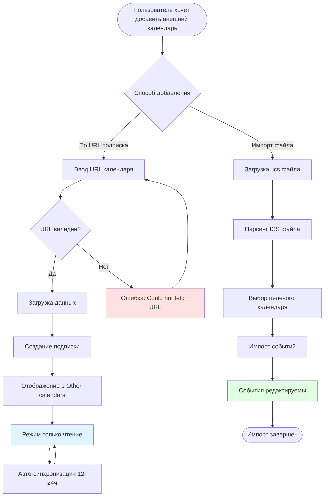
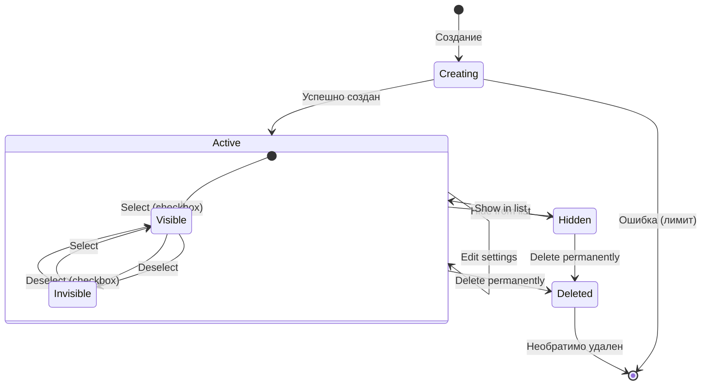
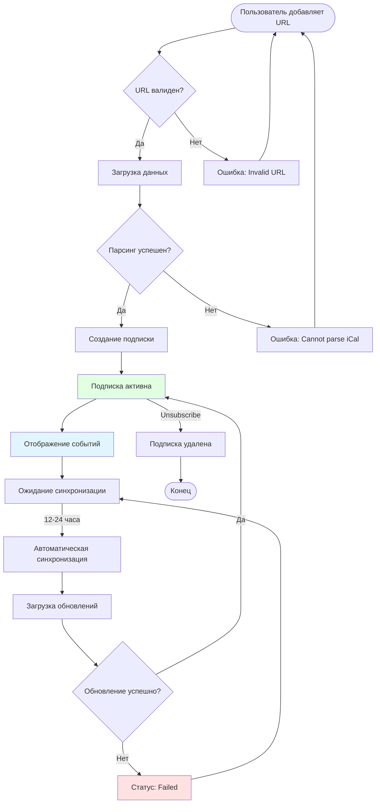

# Управление календарями (Calendar Management)

> **Module ID**: GCAL-003
> **Version**: 1.0.0
> **Last Updated**: 2026-01-09
> **Dependencies**: [Authentication](./01_auth.md), [Events](./02_events.md)

## Executive Summary

Модуль управления календарями в Google Calendar предоставляет функциональность для создания, организации и управления множественными календарями. Пользователи могут создавать собственные календари для различных аспектов жизни (работа, личное, спорт, хобби), подписываться на внешние календари через iCal/URL, добавлять публичные календари (праздники, спортивные события), управлять видимостью и цветовой маркировкой, а также экспортировать данные. Система поддерживает до 60 новых календарей за короткий период и обеспечивает синхронизацию с внешними источниками каждые 24 часа.

---

## Характеристики модуля

| Характеристика | Значение |
|----------------|----------|
| Первичная функция | Создание и управление календарями |
| Максимум новых календарей | 60 за короткий период |
| Типы календарей | Основной, вторичный, подписка, публичный |
| Поддерживаемые форматы импорта | ICS, CSV |
| Интервал синхронизации подписок | До 24 часов |
| Цветовая палитра | 24 предустановленных + пользовательские HEX |
| Формат экспорта | ICS (iCalendar) |

---

## Роли пользователей

| Роль | Описание | Уровень доступа |
|------|----------|-----------------|
| Владелец календаря (Owner) | Создатель или получатель владения | Полный контроль: редактирование, удаление, передача владения, управление доступом |
| Редактор (Make changes and manage sharing) | Максимальный уровень общего доступа | Создание/редактирование событий, управление доступом, экспорт |
| Редактор событий (Make changes to events) | Средний уровень доступа | Создание, редактирование, удаление событий |
| Просмотр деталей (See all event details) | Чтение с деталями | Просмотр всех событий и их деталей |
| Просмотр занятости (See only free/busy) | Минимальный уровень | Только информация о занятости, без деталей событий |
| Администратор Google Workspace | Корпоративный администратор | Управление политиками, передача владения, аудит |

---

## Функциональные требования

### FR-CAL-001: Создание нового календаря
**Приоритет**: P0

> Как пользователь Google Calendar, я хочу создать новый календарь для организации событий определенной категории, чтобы разделить личные, рабочие и другие активности.

**Предусловия**:
- Пользователь авторизован через Google Account
- Количество созданных календарей за короткий период не превышает 60
- Браузер поддерживает современные веб-стандарты

**Основной сценарий**:
1. Пользователь открывает Google Calendar (calendar.google.com)
2. В левой панели находит раздел "Other calendars" (Другие календари)
3. Нажимает значок "+" рядом с заголовком раздела
4. Выбирает "Create new calendar" (Создать календарь) из выпадающего меню
5. Система открывает форму создания календаря с полями:
   - Name (Название) - обязательное поле
   - Description (Описание) - опциональное поле
   - Time zone (Часовой пояс) - по умолчанию из настроек аккаунта
6. Пользователь вводит название календаря
7. Опционально добавляет описание
8. Опционально изменяет часовой пояс
9. Нажимает "Create calendar" (Создать календарь)
10. Система создает календарь и отображает его в списке "My calendars"
11. Календарю автоматически назначается случайный цвет из палитры
12. Календарь сразу становится видимым (checkbox отмечен)

**Альтернативные сценарии**:
- **Сценарий A (Быстрое создание)**: Пользователь нажимает "+" и сразу начинает вводить название без перехода в настройки
- **Сценарий B (Создание через Settings)**: Пользователь открывает Settings > Add calendar > Create new calendar
- **Сценарий C (Лимит достигнут)**: Если создано более 60 календарей за короткий период, система переходит в режим "только чтение" на несколько часов

**Критерии приемки**:
- [ ] AC-001: Каждый календарь получает уникальный идентификатор
- [ ] AC-002: Название календаря обязательно (минимум 1 символ)
- [ ] AC-003: Создатель автоматически становится владельцем календаря
- [ ] AC-004: Календарь по умолчанию приватный (только владелец имеет доступ)
- [ ] AC-005: Система автоматически назначает цвет из предустановленной палитры
- [ ] AC-006: Календарь немедленно появляется в списке "My calendars"

**Бизнес-правила**:
| Rule ID | Правило |
|---------|---------|
| BR-CAL-001 | Каждый календарь имеет уникальный ID в формате [random]@group.calendar.google.com |
| BR-CAL-002 | Создатель календаря автоматически становится его владельцем |
| BR-CAL-003 | Вторичные календари по умолчанию приватные |
| BR-CAL-004 | Максимум 60 новых календарей за короткий период |
| BR-CAL-005 | При превышении лимита аккаунт переходит в режим "только чтение" |
| BR-CAL-006 | Владелец не может понизить свой уровень доступа |

**Метрики**:
| Метрика | Цель | Измерение |
|---------|------|-----------|
| Время создания календаря | < 3 секунды | От нажатия "Create" до появления в списке |
| Успешность создания | > 99.9% | Процент успешных операций |

---

### FR-CAL-002: Удаление календаря
**Приоритет**: P0

> Как владелец календаря, я хочу удалить ненужный календарь, чтобы очистить список календарей и освободить пространство.

**Предусловия**:
- Пользователь является владельцем календаря
- Календарь не является основным (primary) календарем аккаунта

**Основной сценарий**:
1. Пользователь наводит курсор на календарь в левой панели
2. Нажимает на три вертикальные точки (menu icon)
3. Выбирает "Settings and sharing" (Настройки и общий доступ)
4. Система открывает страницу настроек календаря
5. Пользователь прокручивает вниз до раздела "Remove calendar"
6. Нажимает "Delete" (Удалить)
7. Система показывает диалог подтверждения:
   - "Permanently delete [Calendar Name]?"
   - "This calendar will be deleted for everyone you shared it with"
8. Пользователь нажимает "Delete permanently" (Удалить навсегда)
9. Система удаляет календарь и все его события
10. Календарь исчезает из списка у всех пользователей с доступом

**Альтернативные сценарии**:
- **Сценарий A (Отмена удаления)**: Пользователь нажимает "Cancel" в диалоге подтверждения - календарь сохраняется
- **Сценарий B (Скрытие вместо удаления)**: Пользователь снимает галочку с календаря - он скрывается, но не удаляется
- **Сценарий C (Удаление только событий)**: Пользователь выбирает "Delete all events" вместо удаления календаря
- **Сценарий D (Отписка от чужого календаря)**: Для календарей других пользователей опция "Unsubscribe" вместо "Delete"

**Критерии приемки**:
- [ ] AC-001: Только владелец может удалить календарь
- [ ] AC-002: Основной календарь аккаунта нельзя удалить (только очистить)
- [ ] AC-003: Удаление необратимо - восстановление невозможно
- [ ] AC-004: При удалении все события также удаляются
- [ ] AC-005: Все пользователи с общим доступом теряют доступ мгновенно
- [ ] AC-006: Система требует подтверждения перед удалением

**Бизнес-правила**:
| Rule ID | Правило |
|---------|---------|
| BR-CAL-007 | Основной календарь (primary) нельзя удалить |
| BR-CAL-008 | Только владелец может удалить вторичный календарь |
| BR-CAL-009 | Удаление календаря удаляет его для всех пользователей с доступом |
| BR-CAL-010 | Скрытие календаря - обратимое действие, удаление - необратимое |
| BR-CAL-011 | При удалении владельца аккаунта его вторичные календари также удаляются |
| BR-CAL-012 | Администратор может передать владение перед удалением аккаунта |

**Метрики**:
| Метрика | Цель | Измерение |
|---------|------|-----------|
| Время удаления | < 2 секунды | От подтверждения до исчезновения из списка |
| Немедленность для общих пользователей | < 5 секунд | Время до потери доступа |

---

### FR-CAL-003: Цветовая маркировка календарей
**Приоритет**: P1

> Как пользователь с несколькими календарями, я хочу назначать уникальные цвета каждому календарю, чтобы визуально различать события из разных источников.

**Предусловия**:
- Пользователь имеет доступ к одному или нескольким календарям
- Календарь отображается в левой панели

**Основной сценарий**:
1. Пользователь наводит курсор на календарь в левой панели
2. Нажимает на три вертикальные точки (menu icon)
3. Появляется выпадающее меню с цветовой палитрой в верхней части
4. Палитра содержит 24 предустановленных цвета:
   - Tomato, Tangerine, Banana, Sage, Basil, Peacock
   - Blueberry, Lavender, Grape, Flamingo, Graphite, и др.
5. Пользователь нажимает на желаемый цвет
6. Система мгновенно применяет цвет к:
   - Иконке календаря в списке
   - Всем событиям этого календаря в сетке
   - Чипу календаря в предпросмотре событий

**Альтернативные сценарии**:
- **Сценарий A (Пользовательский цвет)**: Пользователь нажимает "+" в палитре, открывается color picker с возможностью ввести HEX-код
- **Сценарий B (Изменение цвета через Settings)**: В Settings > Calendar выбирает цвет в разделе "Calendar color"
- **Сценарий C (Индивидуальный цвет события)**: Для отдельного события можно установить цвет, отличный от календаря

**Критерии приемки**:
- [ ] AC-001: Доступно 24 предустановленных цвета
- [ ] AC-002: Поддерживаются пользовательские цвета через HEX-код (desktop)
- [ ] AC-003: Цвет применяется мгновенно без перезагрузки
- [ ] AC-004: Цвет виден только пользователю, установившему его
- [ ] AC-005: Пользователи с общим доступом видят свои собственные цветовые настройки
- [ ] AC-006: Пользовательские цвета доступны только в web-версии

**Бизнес-правила**:
| Rule ID | Правило |
|---------|---------|
| BR-CAL-013 | Цвета календарей являются персональными настройками просмотра |
| BR-CAL-014 | Цветовые метки видны только пользователю, который их установил |
| BR-CAL-015 | Пользовательские HEX-цвета поддерживаются только в веб-версии |
| BR-CAL-016 | Цвет события может переопределять цвет календаря |
| BR-CAL-017 | При изменении цвета календаря все его события меняют цвет |
| BR-CAL-018 | Для событий доступна та же палитра из 24 цветов |

**Метрики**:
| Метрика | Цель | Измерение |
|---------|------|-----------|
| Время применения цвета | < 200ms | Мгновенное обновление интерфейса |
| Сохранение настроек | < 1 секунда | Синхронизация с сервером |

---

### FR-CAL-004: Управление множественными календарями
**Приоритет**: P0

> Как пользователь, я хочу иметь несколько календарей для разных целей и легко переключаться между ними, чтобы организовать различные сферы своей жизни.

**Предусловия**:
- Пользователь авторизован в Google Calendar
- У пользователя есть минимум основной календарь

**Основной сценарий**:
1. Пользователь открывает Google Calendar
2. В левой панели видит разделы:
   - "My calendars" - собственные календари
   - "Other calendars" - подписки и общие календари
3. Каждый календарь отображается с:
   - Цветной иконкой
   - Названием календаря
   - Checkbox для включения/отключения видимости
4. Пользователь может:
   - Включать/отключать отображение календарей
   - Просматривать события из всех включенных календарей одновременно
   - Создавать события в любом из своих календарей
5. При создании события пользователь выбирает целевой календарь из выпадающего списка
6. События разных календарей отображаются разными цветами

**Альтернативные сценарии**:
- **Сценарий A (Наложение календарей)**: Все включенные календари показываются в одной сетке, события накладываются
- **Сценарий B (Фильтрация по календарю)**: Пользователь отключает все календари кроме одного для фокусированного просмотра
- **Сценарий C (Быстрое скрытие)**: Клик по checkbox скрывает/показывает календарь без удаления
- **Сценарий D (Свернуть раздел)**: Клик по заголовку раздела сворачивает/разворачивает список календарей

**Критерии приемки**:
- [ ] AC-001: Неограниченное количество календарей может быть видимым одновременно
- [ ] AC-002: События всех видимых календарей отображаются в общей сетке
- [ ] AC-003: Каждый календарь имеет уникальный цвет для визуального различения
- [ ] AC-004: Checkbox обеспечивает мгновенное переключение видимости
- [ ] AC-005: Состояние видимости сохраняется между сессиями
- [ ] AC-006: Пользователь может выбрать календарь при создании нового события

**Бизнес-правила**:
| Rule ID | Правило |
|---------|---------|
| BR-CAL-019 | Основной календарь всегда присутствует и не может быть удален |
| BR-CAL-020 | События создаются в основном календаре по умолчанию |
| BR-CAL-021 | Видимость календаря влияет только на отображение, не на доступ |
| BR-CAL-022 | Пользователь может иметь неограниченное количество вторичных календарей |
| BR-CAL-023 | Настройки видимости синхронизируются между устройствами |
| BR-CAL-024 | При конфликте времени события разных календарей отображаются рядом |

**Метрики**:
| Метрика | Цель | Измерение |
|---------|------|-----------|
| Время переключения видимости | < 100ms | Мгновенный отклик интерфейса |
| Загрузка событий нескольких календарей | < 2 секунды | Для 10 активных календарей |

---

### FR-CAL-005: Подписка на внешние календари (iCal/URL)
**Приоритет**: P1

> Как пользователь, я хочу подписаться на внешний календарь по URL (iCal), чтобы автоматически получать обновления событий из внешних источников.

**Предусловия**:
- Пользователь авторизован в Google Calendar
- Внешний календарь опубликован в формате iCal и доступен по URL
- Доступ к функции через веб-версию (не мобильное приложение)

**Основной сценарий**:
1. Пользователь открывает Google Calendar в веб-браузере
2. В левой панели нажимает "+" рядом с "Other calendars"
3. Выбирает "From URL" (По URL)
4. Система отображает форму с полем для ввода URL
5. Пользователь вводит URL календаря (формат .ics или iCal-совместимый)
6. Опционально отмечает checkbox "Make the calendar publicly accessible"
7. Нажимает "Add calendar"
8. Система:
   - Проверяет доступность URL
   - Загружает данные календаря
   - Создает подписку в разделе "Other calendars"
9. Календарь появляется в списке с названием из источника
10. События из подписки отображаются в сетке

**Альтернативные сценарии**:
- **Сценарий A (Недоступный URL)**: Система показывает ошибку "Could not fetch URL" - пользователь проверяет URL
- **Сценарий B (Приватный календарь)**: Если календарь требует аутентификации, URL должен содержать токен доступа
- **Сценарий C (Импорт вместо подписки)**: Пользователь выбирает "Import" для одноразовой загрузки без синхронизации
- **Сценарий D (Подписка через мобильный)**: Пользователь должен использовать веб-версию, функция недоступна в приложениях iOS/Android

**Критерии приемки**:
- [ ] AC-001: Поддерживаются URL в формате iCal (.ics)
- [ ] AC-002: Автоматическое обновление данных до каждых 24 часов
- [ ] AC-003: Подписанный календарь доступен только для чтения
- [ ] AC-004: Пользователь не может редактировать события из подписки
- [ ] AC-005: При удалении источника события исчезают при следующей синхронизации
- [ ] AC-006: Функция доступна только через веб-версию

**Бизнес-правила**:
| Rule ID | Правило |
|---------|---------|
| BR-CAL-025 | Календари по URL доступны только для чтения |
| BR-CAL-026 | Синхронизация происходит каждые 12-24 часа (Google определяет частоту) |
| BR-CAL-027 | URL должен возвращать валидный iCalendar-формат |
| BR-CAL-028 | Подписка через URL недоступна в мобильных приложениях |
| BR-CAL-029 | Изменения в источнике отражаются при следующей синхронизации |
| BR-CAL-030 | Одноразовый импорт (Import) не синхронизируется с источником |

**Метрики**:
| Метрика | Цель | Измерение |
|---------|------|-----------|
| Время первой загрузки | < 10 секунд | Для календаря до 1000 событий |
| Интервал синхронизации | 12-24 часа | Определяется Google автоматически |

---

### FR-CAL-006: Добавление публичных календарей
**Приоритет**: P1

> Как пользователь, я хочу добавить публичные календари (праздники, спортивные события, фазы луны), чтобы видеть важные даты в своем расписании.

**Предусловия**:
- Пользователь авторизован в Google Calendar
- Браузер поддерживает доступ к Google сервисам

**Основной сценарий**:
1. Пользователь открывает Google Calendar
2. В левой панели нажимает "+" рядом с "Other calendars"
3. Выбирает "Browse calendars of interest" (Обзор интересных календарей)
4. Система открывает страницу с категориями:
   - **Regional holidays** (Региональные праздники) - 140+ стран
   - **Phases of the Moon** (Фазы луны)
   - **Religious holidays** (Религиозные праздники)
   - **Sports** (Спортивные события - через внешние источники)
5. Пользователь выбирает категорию "Regional holidays"
6. Появляется список стран с checkbox
7. Пользователь отмечает нужные страны (например, "Holidays in Russia")
8. Система автоматически добавляет выбранные календари
9. Праздники начинают отображаться в сетке

**Альтернативные сценарии**:
- **Сценарий A (Добавление через Settings)**: Settings > Add calendar > Browse calendars of interest
- **Сценарий B (Несколько регионов)**: Пользователь может добавить праздники нескольких стран одновременно
- **Сценарий C (Спортивные календари)**: Для спорта используются внешние источники (ESPN, Yahoo Sports) через URL-подписку
- **Сценарий D (Религиозные праздники)**: Отдельные календари для Christian, Islamic, Jewish, Hindu, Buddhist праздников

**Критерии приемки**:
- [ ] AC-001: Доступны праздники более чем 140 стран
- [ ] AC-002: Публичные календари доступны только для чтения
- [ ] AC-003: Праздники автоматически обновляются Google
- [ ] AC-004: Пользователь может добавить несколько регионов одновременно
- [ ] AC-005: Публичные календари можно скрыть или удалить (отписаться)
- [ ] AC-006: Праздники отображаются как события на весь день

**Бизнес-правила**:
| Rule ID | Правило |
|---------|---------|
| BR-CAL-031 | Публичные календари поддерживаются и обновляются Google |
| BR-CAL-032 | Пользователь не может редактировать события в публичных календарях |
| BR-CAL-033 | Праздники отображаются в часовом поясе пользователя |
| BR-CAL-034 | Региональные праздники включают официальные государственные праздники |
| BR-CAL-035 | Религиозные праздники включают основные даты соответствующих религий |
| BR-CAL-036 | Спортивные календари добавляются через внешние источники (не напрямую от Google) |

**Метрики**:
| Метрика | Цель | Измерение |
|---------|------|-----------|
| Время добавления календаря | < 3 секунды | От выбора до появления событий |
| Покрытие стран | 140+ | Количество доступных региональных календарей |

---

### FR-CAL-007: Управление видимостью календарей
**Приоритет**: P0

> Как пользователь с множеством календарей, я хочу быстро скрывать и показывать отдельные календари, чтобы фокусироваться на релевантных событиях.

**Предусловия**:
- Пользователь имеет несколько календарей в списке
- Календари отображаются в левой панели

**Основной сценарий**:
1. Пользователь видит список календарей в левой панели
2. Рядом с каждым календарем отображается цветной checkbox
3. Пользователь нажимает на checkbox включенного календаря
4. Checkbox снимается (пустой квадрат)
5. Все события этого календаря мгновенно скрываются из сетки
6. Календарь остается в списке (не удаляется)
7. Для повторного показа пользователь нажимает на checkbox снова
8. События снова появляются в сетке

**Альтернативные сценарии**:
- **Сценарий A (Скрыть из списка)**: Menu > "Hide from list" - календарь полностью скрывается из левой панели
- **Сценарий B (Показать скрытые)**: Settings > Calendars > показать все скрытые календари
- **Сценарий C (Режим одного календаря)**: Пользователь отключает все кроме одного для фокусированного просмотра
- **Сценарий D (Массовое управление)**: Свернуть/развернуть раздел "My calendars" для быстрой навигации

**Критерии приемки**:
- [ ] AC-001: Переключение видимости происходит мгновенно
- [ ] AC-002: Скрытие календаря не удаляет его события
- [ ] AC-003: Настройки видимости сохраняются между сессиями
- [ ] AC-004: Скрытые календари можно восстановить
- [ ] AC-005: "Hide from list" полностью убирает календарь из панели
- [ ] AC-006: Видимость влияет только на отображение, не на доступ

**Бизнес-правила**:
| Rule ID | Правило |
|---------|---------|
| BR-CAL-037 | Видимость - персональная настройка, не влияет на других пользователей |
| BR-CAL-038 | Скрытие не влияет на уведомления (они продолжают приходить) |
| BR-CAL-039 | Скрытый календарь можно вернуть через Settings |
| BR-CAL-040 | Владельцу всегда видны его календари в Settings |
| BR-CAL-041 | "Hide from list" не влияет на общий доступ |
| BR-CAL-042 | При поиске события находятся даже в скрытых календарях |

**Метрики**:
| Метрика | Цель | Измерение |
|---------|------|-----------|
| Время переключения | < 100ms | Мгновенный отклик UI |
| Сохранение состояния | < 1 секунда | Синхронизация с сервером |

---

### FR-CAL-008: Экспорт календарей
**Приоритет**: P1

> Как владелец календаря, я хочу экспортировать все события в файл ICS, чтобы создать резервную копию или перенести данные в другое приложение.

**Предусловия**:
- Пользователь авторизован в Google Calendar
- Пользователь имеет доступ с правом экспорта ("Make changes and manage sharing")
- Доступ через веб-версию (не мобильное приложение)

**Основной сценарий (Экспорт всех календарей)**:
1. Пользователь открывает Google Calendar в веб-браузере
2. Нажимает Settings (шестеренка) в правом верхнем углу
3. Переходит в Settings (Настройки)
4. В левом меню выбирает "Import & export"
5. В разделе "Export" нажимает кнопку "Export"
6. Система формирует ZIP-архив со всеми календарями пользователя
7. Каждый календарь экспортируется в отдельный .ics файл
8. ZIP-файл автоматически скачивается в папку Downloads

**Альтернативный сценарий (Экспорт одного календаря)**:
1. Пользователь открывает Settings > [Calendar Name]
2. Прокручивает до раздела "Calendar settings"
3. Нажимает "Export calendar"
4. Система скачивает .ics файл только для выбранного календаря

**Критерии приемки**:
- [ ] AC-001: Экспорт доступен только в веб-версии
- [ ] AC-002: Формат экспорта - iCalendar (.ics)
- [ ] AC-003: Экспорт всех календарей создает ZIP-архив
- [ ] AC-004: Каждый календарь - отдельный .ics файл
- [ ] AC-005: Для экспорта требуется право "Make changes and manage sharing"
- [ ] AC-006: Экспорт отдельного события невозможен - только весь календарь

**Бизнес-правила**:
| Rule ID | Правило |
|---------|---------|
| BR-CAL-043 | Экспортируются все события календаря без исключения |
| BR-CAL-044 | Формат iCalendar совместим с большинством календарных приложений |
| BR-CAL-045 | Нельзя экспортировать отдельное событие - только весь календарь |
| BR-CAL-046 | Для экспорта общего календаря нужны соответствующие права |
| BR-CAL-047 | Экспорт недоступен в мобильных приложениях |
| BR-CAL-048 | Большие календари могут занять время на формирование |

**Метрики**:
| Метрика | Цель | Измерение |
|---------|------|-----------|
| Время экспорта | < 10 секунд | Для календаря с 1000 событиями |
| Размер файла | Варьируется | Зависит от количества событий |

---

### FR-CAL-009: Импорт календарей
**Приоритет**: P1

> Как пользователь, я хочу импортировать события из файла ICS или CSV, чтобы перенести данные из другого календарного приложения.

**Предусловия**:
- Пользователь авторизован в Google Calendar
- Файл в формате ICS или CSV
- Доступ через веб-версию

**Основной сценарий**:
1. Пользователь открывает Google Calendar в веб-браузере
2. Переходит в Settings > Import & export
3. В разделе "Import" нажимает "Select file from your computer"
4. Выбирает файл .ics или .csv
5. Система отображает предпросмотр с количеством событий
6. Пользователь выбирает целевой календарь из выпадающего списка
7. Нажимает "Import"
8. Система импортирует события в выбранный календарь
9. Отображается сообщение об успешном импорте с количеством добавленных событий

**Альтернативные сценарии**:
- **Сценарий A (ZIP-файл)**: Пользователь загружает ZIP с несколькими .ics файлами - импортирует каждый отдельно
- **Сценарий B (Дубликаты)**: Некоторые события уже существуют - создаются дубликаты
- **Сценарий C (Большой файл)**: Файл слишком большой - импорт может не выполниться
- **Сценарий D (Ошибка формата)**: Файл поврежден или неверного формата - система показывает ошибку

**Критерии приемки**:
- [ ] AC-001: Поддерживаются форматы ICS и CSV
- [ ] AC-002: Импорт - одноразовая операция (без синхронизации)
- [ ] AC-003: Импортированные события становятся редактируемыми
- [ ] AC-004: Пользователь выбирает целевой календарь
- [ ] AC-005: Система предупреждает о возможных дубликатах
- [ ] AC-006: Поддерживается импорт из ZIP-архива

**Бизнес-правила**:
| Rule ID | Правило |
|---------|---------|
| BR-CAL-049 | Импорт создает локальные копии событий (не ссылки) |
| BR-CAL-050 | Дубликаты могут создаваться при повторном импорте |
| BR-CAL-051 | Часовые пояса конвертируются согласно настройкам пользователя |
| BR-CAL-052 | Большие файлы могут вызвать ошибку импорта |
| BR-CAL-053 | Импортированные события полностью редактируемы |
| BR-CAL-054 | Изменения в оригинальном файле не отражаются в импортированных событиях |

**Метрики**:
| Метрика | Цель | Измерение |
|---------|------|-----------|
| Время импорта | < 30 секунд | Для файла с 1000 событиями |
| Успешность импорта | > 99% | Для валидных файлов |

---

### FR-CAL-010: Настройки общего доступа к календарю
**Приоритет**: P1

> Как владелец календаря, я хочу предоставить доступ к календарю другим пользователям с различными уровнями прав, чтобы организовать совместную работу.

**Предусловия**:
- Пользователь является владельцем календаря
- Календарь открыт в режиме настроек

**Основной сценарий**:
1. Пользователь открывает настройки календаря (Menu > Settings and sharing)
2. Переходит в раздел "Share with specific people or groups"
3. Нажимает "+ Add people and groups"
4. Вводит email-адрес пользователя или группы
5. Выбирает уровень доступа из выпадающего списка:
   - See only free/busy (hide details)
   - See all event details
   - Make changes to events
   - Make changes and manage sharing
6. Нажимает "Send"
7. Приглашенный пользователь получает email-уведомление
8. Календарь появляется в их разделе "Other calendars"

**Альтернативные сценарии**:
- **Сценарий A (Публичный доступ)**: В разделе "Access permissions" включает "Make available to public"
- **Сценарий B (Доступ для организации)**: Включает "Make available for [Organization]"
- **Сценарий C (Изменение прав)**: Редактирует уровень доступа для существующего пользователя
- **Сценарий D (Удаление доступа)**: Нажимает X рядом с пользователем для отзыва доступа

**Критерии приемки**:
- [ ] AC-001: Доступны четыре уровня разрешений
- [ ] AC-002: Владелец не может понизить свой уровень доступа
- [ ] AC-003: Приглашенный получает email-уведомление
- [ ] AC-004: Изменения прав применяются мгновенно
- [ ] AC-005: Можно предоставить доступ группам Google
- [ ] AC-006: Публичный доступ делает календарь видимым всем

**Бизнес-правила**:
| Rule ID | Правило |
|---------|---------|
| BR-CAL-055 | Только владелец может удалить календарь |
| BR-CAL-056 | Уровень доступа владельца не может быть понижен |
| BR-CAL-057 | Пользователь с "Make changes and manage sharing" может управлять доступом других |
| BR-CAL-058 | "See only free/busy" скрывает детали событий |
| BR-CAL-059 | Публичный календарь доступен всем по ссылке |
| BR-CAL-060 | Администратор организации может ограничить внешний общий доступ |

**Метрики**:
| Метрика | Цель | Измерение |
|---------|------|-----------|
| Время предоставления доступа | < 2 секунды | От нажатия "Send" до применения |
| Доставка уведомления | < 5 минут | Email-уведомление приглашенному |

---

### FR-CAL-011: Передача владения календарем
**Приоритет**: P1

> Как владелец вторичного календаря, я хочу передать владение другому пользователю, чтобы он мог полностью управлять календарем.

**Предусловия**:
- Пользователь является владельцем вторичного календаря
- Новый владелец уже имеет доступ к календарю
- Новый владелец принадлежит той же организации (для Workspace)

**Основной сценарий**:
1. Пользователь открывает настройки календаря
2. Переходит в раздел "Share with specific people"
3. Находит пользователя, которому хочет передать владение
4. Нажимает на выпадающий список уровня доступа
5. Выбирает "Transfer ownership" (Передать владение)
6. Система показывает подтверждение
7. Пользователь подтверждает передачу
8. Новый владелец получает уведомление
9. После принятия:
   - Новый пользователь становится владельцем
   - Предыдущий владелец получает уровень "Make changes and manage sharing"

**Альтернативные сценарии**:
- **Сценарий A (Передача админом)**: Администратор Google Workspace передает владение через Admin Console
- **Сценарий B (Отклонение передачи)**: Новый владелец отклоняет - владение остается у текущего владельца
- **Сценарий C (Удаление аккаунта)**: При удалении владельца календарь удаляется, если не передан заранее

**Критерии приемки**:
- [ ] AC-001: Можно передать владение только пользователю с существующим доступом
- [ ] AC-002: Новый владелец должен принять передачу
- [ ] AC-003: Предыдущий владелец сохраняет максимальный общий доступ
- [ ] AC-004: Администратор может передать владение через Admin Console
- [ ] AC-005: Нельзя передать владение основным (primary) календарем
- [ ] AC-006: Каждый вторичный календарь имеет ровно одного владельца

**Бизнес-правила**:
| Rule ID | Правило |
|---------|---------|
| BR-CAL-061 | Каждый вторичный календарь имеет единственного владельца |
| BR-CAL-062 | При создании создатель автоматически становится владельцем |
| BR-CAL-063 | Уровень доступа владельца не может быть понижен |
| BR-CAL-064 | Только владелец может удалить календарь |
| BR-CAL-065 | При удалении аккаунта владельца его календари удаляются |
| BR-CAL-066 | Администратор может передать владение перед удалением аккаунта |

**Метрики**:
| Метрика | Цель | Измерение |
|---------|------|-----------|
| Время передачи | < 2 секунды | После принятия новым владельцем |
| Уведомление | < 5 минут | Email новому владельцу |

---

### FR-CAL-012: Получение ссылки на календарь
**Приоритет**: P2

> Как владелец публичного календаря, я хочу получить ссылки для встраивания и публичного доступа, чтобы поделиться календарем на веб-сайтах и с внешними пользователями.

**Предусловия**:
- Пользователь владеет календарем или имеет права на управление
- Календарь настроен как публичный или доступный по ссылке

**Основной сценарий**:
1. Пользователь открывает настройки календаря
2. Переходит в раздел "Integrate calendar"
3. Видит несколько типов ссылок:
   - **Calendar ID** - уникальный идентификатор
   - **Public URL to this calendar** - ссылка для просмотра в браузере
   - **Embed code** - HTML-код для встраивания на сайт
   - **iCal format** - ссылка в формате iCal для подписки
4. Пользователь копирует нужную ссылку
5. Использует ссылку для:
   - Встраивания календаря на веб-сайт
   - Предоставления доступа внешним пользователям
   - Подписки в других календарных приложениях

**Альтернативные сценарии**:
- **Сценарий A (Приватный iCal)**: Для приватных календарей генерируется секретный URL с токеном
- **Сценарий B (Сброс секретного URL)**: Пользователь может сбросить секретный URL для безопасности
- **Сценарий C (Настройка embed)**: Настройка параметров встраивания (размер, цвета, отображение)

**Критерии приемки**:
- [ ] AC-001: Публичные ссылки работают без авторизации
- [ ] AC-002: Секретные ссылки содержат уникальный токен
- [ ] AC-003: Embed-код создает iframe с календарем
- [ ] AC-004: iCal-ссылка совместима со стандартом RFC 5545
- [ ] AC-005: Секретный URL можно сбросить и сгенерировать новый
- [ ] AC-006: При сбросе старые ссылки перестают работать

**Бизнес-правила**:
| Rule ID | Правило |
|---------|---------|
| BR-CAL-067 | Публичный URL требует настройки публичного доступа |
| BR-CAL-068 | Секретный iCal URL позволяет подписаться без авторизации |
| BR-CAL-069 | Сброс секретного URL делает старые ссылки недействительными |
| BR-CAL-070 | Embed-код позволяет настраивать внешний вид |
| BR-CAL-071 | Calendar ID уникален и не меняется |
| BR-CAL-072 | Секретный URL следует хранить конфиденциально |

**Метрики**:
| Метрика | Цель | Измерение |
|---------|------|-----------|
| Генерация ссылки | < 1 секунда | Мгновенное отображение |
| Загрузка embed | < 3 секунды | Рендеринг на внешнем сайте |

---

## Сущности данных

### Calendar (Календарь)
- **calendar_id** - уникальный идентификатор (формат: xxx@group.calendar.google.com)
- **summary** - название календаря (1-250 символов)
- **description** - описание календаря (опционально)
- **time_zone** - часовой пояс по умолчанию
- **location** - местоположение (опционально)
- **primary** - флаг основного календаря (boolean)
- **color_id** - ID предустановленного цвета (1-24)
- **background_color** - HEX-код фона
- **foreground_color** - HEX-код текста
- **hidden** - скрыт из списка (boolean)
- **selected** - отображается в сетке (boolean)
- **access_role** - роль текущего пользователя (owner/writer/reader/freeBusyReader)
- **default_reminders** - настройки напоминаний по умолчанию
- **conference_properties** - настройки видеоконференций
- **created** - дата создания
- **updated** - дата последнего обновления
- **etag** - версия для оптимистичной блокировки

### CalendarListEntry (Запись в списке календарей)
- **id** - идентификатор календаря
- **summary** - название (может отличаться от оригинала)
- **summary_override** - пользовательское название
- **color_id** - персональный цвет
- **background_color** - персональный HEX-код фона
- **foreground_color** - персональный HEX-код текста
- **hidden** - скрыт из списка
- **selected** - отображается в сетке
- **access_role** - роль пользователя
- **default_reminders** - персональные напоминания
- **notification_settings** - настройки уведомлений
- **primary** - основной календарь пользователя

### CalendarACL (Права доступа)
- **id** - идентификатор правила
- **calendar_id** - идентификатор календаря
- **scope_type** - тип области (user/group/domain/default)
- **scope_value** - значение области (email, домен, или пусто для default)
- **role** - уровень доступа (owner/writer/reader/freeBusyReader/none)
- **etag** - версия для оптимистичной блокировки

### Subscription (Подписка)
- **calendar_id** - идентификатор подписки
- **source_url** - URL источника iCal
- **refresh_interval** - интервал обновления
- **last_synced** - время последней синхронизации
- **sync_status** - статус синхронизации (success/failed/pending)
- **error_message** - сообщение об ошибке (если есть)

---

## Состояния и статусы

### Статусы календаря
- **active** - активный календарь, отображается и синхронизируется
- **hidden** - скрыт из списка, но существует
- **deleted** - удален (необратимо)

### Статусы видимости
- **visible** - события отображаются в сетке (checkbox отмечен)
- **hidden** - события не отображаются (checkbox снят)

### Статусы синхронизации подписки
- **synced** - успешно синхронизирован
- **syncing** - идет синхронизация
- **failed** - ошибка синхронизации
- **pending** - ожидает синхронизации

### Уровни доступа (Access Roles)
- **owner** - владелец, полный контроль
- **writer** - редактор, может изменять события и управлять доступом
- **reader** - читатель, видит все детали событий
- **freeBusyReader** - видит только занятость

### Типы области доступа (Scope Types)
- **user** - конкретный пользователь (email)
- **group** - группа Google (email группы)
- **domain** - весь домен организации
- **default** - все пользователи (публичный доступ)

---

## Диаграмма состояний календаря

---

## Диаграмма жизненного цикла подписки

---

## Ограничения и лимиты

### Лимиты создания
- **Максимум новых календарей**: 60 за короткий период
- **Максимум событий**: 10,000-100,000 за короткий период
- **После превышения лимита**: Режим "только чтение" на несколько часов

### Лимиты общего доступа
- **Максимум получателей общего доступа**: 750 за короткий период
- **Максимум внешних приглашений**: 10,000 людей вне организации
- **Максимум email гостям**: 2,000 внешним пользователям

### Лимиты подписок
- **Интервал синхронизации**: 12-24 часа (определяется Google)
- **Размер импортируемого файла**: Зависит от количества событий

### Различия между типами аккаунтов
- **Бесплатные аккаунты (Gmail)**: Строгие лимиты
- **Google Workspace**: Повышенные лимиты после оплаты $100 и 60 дней
- **Триальные аккаунты**: Строгие лимиты

---

## User Stories

### US-CAL-001: Организация рабочих и личных событий
> Как занятой профессионал, я хочу иметь отдельные календари для работы и личной жизни, чтобы четко разделять эти сферы и легко показывать коллегам только рабочее расписание.

**Acceptance Criteria**:
- Могу создать календарь "Работа" с синим цветом
- Могу создать календарь "Личное" с зеленым цветом
- Могу поделиться только рабочим календарем с командой
- Могу скрывать личный календарь во время рабочих презентаций

### US-CAL-002: Семейный общий календарь
> Как член семьи, я хочу создать общий семейный календарь, чтобы все члены семьи видели важные события и могли добавлять свои.

**Acceptance Criteria**:
- Могу создать календарь "Семья"
- Могу пригласить членов семьи с правами редактирования
- Все члены видят события друг друга
- Каждый может добавлять новые события

### US-CAL-003: Отслеживание праздников нескольких стран
> Как сотрудник международной компании, я хочу видеть праздники нескольких стран, чтобы планировать встречи с учетом нерабочих дней коллег.

**Acceptance Criteria**:
- Могу добавить праздники России
- Могу добавить праздники США
- Могу добавить праздники Германии
- Праздники отображаются разными цветами
- Могу скрывать/показывать праздники каждой страны

### US-CAL-004: Подписка на расписание мероприятий
> Как участник сообщества, я хочу подписаться на публичный календарь мероприятий, чтобы автоматически получать обновления о новых событиях.

**Acceptance Criteria**:
- Могу добавить календарь по iCal URL
- События автоматически обновляются
- Не могу редактировать события из подписки
- Могу отписаться в любой момент

### US-CAL-005: Миграция календаря из другого приложения
> Как новый пользователь Google Calendar, я хочу импортировать события из Outlook, чтобы не потерять свою историю и предстоящие встречи.

**Acceptance Criteria**:
- Могу импортировать файл .ics из Outlook
- Все события сохраняются с правильными датами
- Часовые пояса корректно конвертируются
- Импортированные события можно редактировать

---

## Интеграция с другими модулями

### Модуль "Аутентификация и управление аккаунтом"
- Создание календарей требует авторизации через Google Account
- Календари привязаны к владельцу (Google Account ID)
- Настройки приватности контролируются через Google Account
- **Ссылка**: [Authentication Module](./01_auth.md)

### Модуль "События"
- События создаются в контексте конкретного календаря
- Цвет события наследуется от календаря (если не переопределен)
- При удалении календаря удаляются все его события
- **Ссылка**: [Events Module](./02_events.md)

### Модуль "Уведомления"
- Настройки уведомлений привязаны к календарю
- Скрытие календаря не отключает уведомления
- Подписки могут иметь собственные настройки уведомлений
- **Ссылка**: [Notifications Module](./04_notifications.md)

### Модуль "Общий доступ"
- Управление правами доступа к календарям
- Уровни разрешений (owner, writer, reader, freeBusyReader)
- Публичный и ограниченный доступ
- **Ссылка**: [Sharing Module](./05_sharing.md)

### Google Workspace Admin
- Администраторы могут управлять политиками общего доступа
- Передача владения через Admin Console
- Ограничение внешнего общего доступа
- Аудит операций с календарями

---

## Источники

**Официальная документация Google**:
- [Create a new calendar - Google Calendar Help](https://support.google.com/calendar/answer/37095?hl=en)
- [Delete or unsubscribe from a calendar - Google Calendar Help](https://support.google.com/calendar/answer/37188?hl=en)
- [Share your calendar - Google Calendar Help](https://support.google.com/calendar/answer/37082?hl=en)
- [Export events from your Google Calendar - Google Calendar Help](https://support.google.com/calendar/answer/37111?hl=en)
- [Import events to Google Calendar - Google Calendar Help](https://support.google.com/calendar/answer/37118?hl=en)
- [Subscribe to someone else's calendar - Google Calendar Help](https://support.google.com/calendar/answer/37100?hl=en)
- [Add or remove holidays on your calendar - Google Calendar Help](https://support.google.com/calendar/answer/13748345?hl=en)
- [Avoid Calendar use limits - Google Workspace Admin Help](https://support.google.com/a/answer/2905486?hl=en)

**Обновления Google Workspace**:
- [Improving secondary calendar management with dedicated owners](https://workspaceupdates.googleblog.com/2025/11/secondary-calendar-management-with-dedicated-owners.html)
- [Control access to a shared calendar - Google Calendar Help](https://support.google.com/calendar/answer/15716974?hl=en)
- [Transfer calendars or events in Google Calendar](https://support.google.com/calendar/answer/78739?hl=en)

**Руководства по цветам и настройкам**:
- [Use color labels to track calendar entries - Google Calendar Help](https://support.google.com/calendar/answer/12377581?hl=en)
- [Personalize Calendar - Google Workspace Learning Center](https://support.google.com/a/users/answer/9323423?hl=en)
- [Change the visibility of events on your calendar - Google Calendar Help](https://support.google.com/calendar/answer/34580?hl=en)

**Внешние ресурсы**:
- [How to Subscribe to a Web (ICS) Calendar in Google Calendar](https://www.onecal.io/blog/how-to-subscribe-to-a-web-ics-calendar-in-google-calendar)
- [10 Free Calendars You Should Add to Your Google Calendar](https://www.makeuseof.com/tag/free-calendars-add-google-calendar/)
- [Google Calendar Limits](https://www.greminders.com/articles/google-calendar-limits/)

---

**Примечание**: Эта спецификация описывает бизнес-логику и функциональные требования для модуля управления календарями Google Calendar. Спецификация не содержит технических деталей реализации, архитектуры системы или API endpoints.
