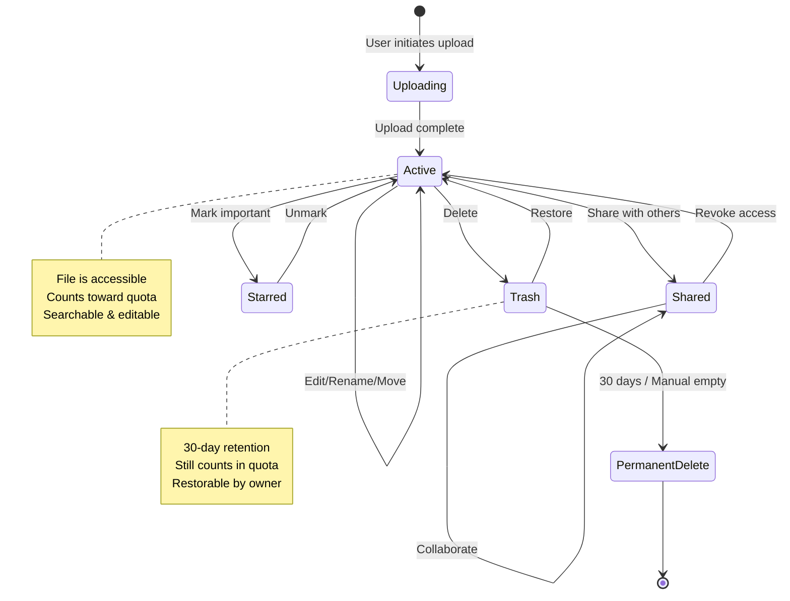

# Module 02: File Storage & Management

> **Module Type:** Core
> **Priority:** P0 (Critical)
> **Implementation Complexity:** Very High
> **Dependencies:** [Authentication](../common/auth.md), Search Module, Sync Module

---

## Executive Summary

**What it is:** Core file storage and management system providing upload, organization, and lifecycle management of files and folders in Google Drive.

**Key capabilities:**
- Multi-method file upload (web, drag-drop, desktop sync) with 5TB file size limit
- Hierarchical folder organization with 100-level nesting support
- Complete file lifecycle (create, read, update, delete, restore)
- Storage quota management (15GB free, expandable to 30TB)
- Format conversion and preview for 100+ file types
- Advanced organization features (starred, recent, priority, workspaces)

**Scale & Performance:**
- Up to 500,000 items per folder
- 750GB/24h upload bandwidth limit per user
- 30-day trash retention with instant restoration
- Real-time synchronization across all devices

---

## Metrics Overview

| Metric | Value | Description |
|--------|-------|-------------|
| **Functional Requirements** | 16 FRs | Total requirements in this module |
| **Max File Size** | 5 TB | Maximum individual file size |
| **Upload Bandwidth** | 750 GB/24h | Daily upload limit per user |
| **Folder Nesting** | 100 levels | Maximum folder depth |
| **Items Per Folder** | 500,000 | Maximum files/folders in single folder |
| **Free Storage** | 15 GB | Shared across Drive, Gmail, Photos |
| **Max Storage** | 30 TB | Via Google One subscription |
| **Trash Retention** | 30 days | Auto-delete after period |
| **Supported Formats** | 100+ | File types with preview support |
| **Workspace Limit** | 25 | Max workspaces per user |
| **Files Per Workspace** | 25 | Max files per workspace |

---

## User Roles

| Role | Capabilities | Access Level |
|------|-------------|--------------|
| **Owner** | Full control: edit, delete, share, manage permissions | Complete |
| **Editor** | Edit files, upload to shared folders, create files | Read/Write |
| **Commenter** | Add comments, view and suggest changes | Read/Comment |
| **Viewer** | View and download files only | Read-only |
| **Workspace Admin** | Manage quotas, policies, team drives | Administrative |
| **Shared Drive Organizer** | Manage files and members in shared drives | Team Management |

---

## File Lifecycle Diagram



---

## Common Module References

This module implements file storage patterns. For related functionality, see:

- **[Authentication](../common/auth.md)** - User session management and access control
- **[Media Upload](../common/media_upload.md)** - Standard upload patterns and processing
- **File Sharing** - See Module 04: Sharing & Collaboration
- **Version Control** - See Module 08: Version History
- **Offline Sync** - See Module 06: Sync & Offline Access

---

## Functional Requirements

### FR-GDRIVE-STR-001: Upload File via Web Interface

**Priority:** P0 (Critical)
**Complexity:** Medium
**Dependencies:** Authentication, Storage Quota API

#### User Stories

```
AS A personal user
I WANT TO upload files from my computer to Google Drive via web browser
SO THAT I can access them from any device and share with others

AS A business user
I WANT TO upload multiple files simultaneously with progress tracking
SO THAT I can efficiently manage large file transfers for my team

AS AN education user
I WANT TO upload course materials and assignments
SO THAT students can access learning resources anytime
```

#### Functional Requirements

**Must Have (P0):**
- [ ] User can select single or multiple files via file picker dialog
- [ ] Upload progress indicator shows real-time percentage and estimated time
- [ ] Files upload to currently selected folder or My Drive root
- [ ] Support for all file types without restrictions
- [ ] Resume capability for interrupted uploads
- [ ] Duplicate name handling with auto-numbering (filename (1), filename (2))

**Should Have (P1):**
- [ ] Parallel upload of up to 15 files simultaneously
- [ ] Upload queue management with pause/resume/cancel controls
- [ ] Upload complete notification with success/failure status
- [ ] Bandwidth throttling options for controlled upload speed

**Nice to Have (P2):**
- [ ] Drag-select multiple files in file picker with preview
- [ ] Upload history with retry failed uploads
- [ ] Automatic retry on network errors (3 attempts)

#### Acceptance Criteria

```
GIVEN I am logged in to Google Drive web interface
WHEN I click "+ New" and select "File upload"
THEN system file picker dialog opens

GIVEN file picker is open
WHEN I select one or more files and click "Open"
THEN files begin uploading with progress indicator in bottom-right corner
AND I can see percentage complete and upload speed for each file
AND I can cancel individual uploads or entire batch

GIVEN upload is in progress
WHEN internet connection is lost temporarily
THEN upload pauses and automatically resumes when connection restored
AND no data is lost or needs re-upload

GIVEN file with same name exists in destination folder
WHEN upload completes
THEN system creates copy with suffix " (1)", " (2)", etc.
OR (optional) prompts user to replace or rename

GIVEN I exceed 750GB upload limit in 24 hours
WHEN I try to upload another file
THEN upload is blocked with error message "Upload quota exceeded. Try again in X hours"
```

#### Business Rules

- **BR-GDRIVE-STR-001:** Maximum file size: 5 TB per file
- **BR-GDRIVE-STR-002:** Maximum upload bandwidth: 750 GB per 24-hour period per user
- **BR-GDRIVE-STR-003:** Parallel uploads: Up to 15 files simultaneously
- **BR-GDRIVE-STR-004:** Filename length: Maximum 255 characters
- **BR-GDRIVE-STR-005:** Forbidden characters in filename: / \ < > : " | ? *
- **BR-GDRIVE-STR-006:** Upload resume: Supported via resumable upload protocol
- **BR-GDRIVE-STR-007:** Duplicate handling: Auto-suffix " (1)", " (2)", etc. by default
- **BR-GDRIVE-STR-008:** File validation: No virus scanning during upload (scanned after completion)
- **BR-GDRIVE-STR-009:** Ownership: Uploader becomes file owner automatically

---

### FR-GDRIVE-STR-002: Upload via Drag & Drop

**Priority:** P0 (Critical)
**Complexity:** Medium
**Dependencies:** HTML5 Drag & Drop API, FR-GDRIVE-STR-001

#### User Stories

```
AS A personal user
I WANT TO drag files from my desktop directly into Drive browser window
SO THAT I can quickly upload files without navigating file picker dialogs

AS A business user
I WANT TO drag entire project folders with nested structure
SO THAT I can preserve folder hierarchy when uploading to shared team drives

AS AN education user
I WANT TO drag and drop multiple assignment files at once
SO THAT I can quickly organize classroom materials
```

#### Functional Requirements

**Must Have (P0):**
- [ ] Drag one or more files from OS file manager to Drive interface
- [ ] Visual drop zone indication (highlight/border) when dragging over valid area
- [ ] Preserve folder structure when dragging folders (nested files/subfolders)
- [ ] Upload to folder where files are dropped
- [ ] Same upload progress and queue management as web upload

**Should Have (P1):**
- [ ] Drop directly onto specific folder icons for targeted upload
- [ ] Visual preview of files being dragged (count, total size)
- [ ] Confirmation dialog for large folder uploads (>100 files)

**Nice to Have (P2):**
- [ ] Drag from external sources (email attachments, other web apps)
- [ ] Multi-window drag & drop (from one Drive window to another)

#### Acceptance Criteria

```
GIVEN I have files selected in my OS file manager
WHEN I drag them over the Google Drive browser window
THEN a visual indicator shows "Drop files here to upload"
AND the drop zone is highlighted

GIVEN files are being dragged over Drive
WHEN I hover over a specific folder icon
THEN that folder is highlighted as drop target
AND files will upload to that folder when dropped

GIVEN I drag a folder with 50 files and 5 subfolders
WHEN I drop it into Drive
THEN entire folder structure is recreated in Drive
AND all files upload with preserved relative paths
AND upload progress shows "Uploading 50 files from FolderName"

GIVEN I drag files with total size exceeding available storage quota
WHEN I drop the files
THEN system displays error "Not enough storage space. X GB needed, Y GB available"
AND no files are uploaded
```

#### Business Rules

- **BR-GDRIVE-STR-010:** Drag & drop inherits all upload limits from FR-GDRIVE-STR-001
- **BR-GDRIVE-STR-011:** Folder structure preservation: Up to 100 nesting levels
- **BR-GDRIVE-STR-012:** Browser support: Requires modern browsers with HTML5 DnD API
- **BR-GDRIVE-STR-013:** Drop target: Any valid folder location (My Drive, Shared Drive, writable folders)
- **BR-GDRIVE-STR-014:** Visual feedback: Drop zone must be clearly indicated before drop
- **BR-GDRIVE-STR-015:** Empty folders: Preserved in structure (created even if empty)

---

### FR-GDRIVE-STR-003: Desktop Sync Application

**Priority:** P0 (Critical)
**Complexity:** Very High
**Dependencies:** Google Drive for Desktop app, Authentication, File System APIs

#### User Stories

```
AS A personal user
I WANT TO access Drive files as if they were local on my computer
SO THAT I can work with files using my preferred desktop applications

AS A business user
I WANT TO sync team folders automatically to my workstation
SO THAT I always have latest versions without manual downloads

AS AN education user
I WANT TO work offline on lecture materials during commute
SO THAT I can prepare classes without internet connectivity
```

#### Functional Requirements

**Must Have (P0):**
- [ ] Install Google Drive for Desktop on Windows 10+, macOS 10.14+, ChromeOS
- [ ] Mount Drive as virtual disk (G: drive on Windows, /Volumes/GoogleDrive on macOS)
- [ ] Two sync modes: Stream (on-demand) and Mirror (full copy)
- [ ] Automatic bi-directional sync of changes (local ↔ cloud)
- [ ] Sync status indicators (syncing, synced, error)
- [ ] Selective folder sync configuration
- [ ] Real-time change detection and sync (within seconds)

**Should Have (P1):**
- [ ] Offline file availability marking (right-click → Make available offline)
- [ ] Conflict resolution for simultaneous edits (create conflict copy)
- [ ] Bandwidth limiting options
- [ ] Sync pause/resume controls
- [ ] System tray notifications for sync events

**Nice to Have (P2):**
- [ ] Network quality adaptation (slower sync on metered connections)
- [ ] Scheduled sync times
- [ ] Exclude file patterns (*.tmp, ~$*, etc.)

#### Acceptance Criteria

```
GIVEN I install Google Drive for Desktop and sign in
WHEN installation completes
THEN virtual drive appears in file explorer as "Google Drive (G:)"
AND I can browse My Drive contents as regular folders
AND system tray shows Google Drive icon with sync status

GIVEN I create a new file in local Google Drive folder
WHEN file is saved
THEN sync begins automatically within 5 seconds
AND file appears in web Drive interface
AND tray icon shows "Syncing" animation

GIVEN I edit a file simultaneously on web and desktop
WHEN both saves complete
THEN system creates conflict copy named "Filename (Conflicted copy 2025-12-29)"
AND both versions are preserved
AND I receive notification about conflict

GIVEN I select Stream mode
WHEN I open a large file (2GB)
THEN file streams from cloud without full download
AND only accessed portions are cached locally
AND available storage on my disk is not reduced by 2GB

GIVEN I select Mirror mode
WHEN sync completes
THEN all files are fully downloaded to local disk
AND I can access all files without internet
AND files remain accessible after disconnecting internet
```

#### Business Rules

- **BR-GDRIVE-STR-016:** Sync modes: Stream (on-demand) or Mirror (full copy)
- **BR-GDRIVE-STR-017:** Sync interval: Real-time detection with ~5 second latency
- **BR-GDRIVE-STR-018:** Bandwidth limit: 750 GB/24h applies to desktop uploads
- **BR-GDRIVE-STR-019:** Conflict strategy: Create copy, never auto-overwrite
- **BR-GDRIVE-STR-020:** File locking: Not supported, conflicts handled post-save
- **BR-GDRIVE-STR-021:** Delete behavior: Local delete moves file to Drive trash
- **BR-GDRIVE-STR-022:** Rename sync: Instant propagation
- **BR-GDRIVE-STR-023:** Version history: All synced changes create version entries
- **BR-GDRIVE-STR-024:** Selective sync: Can choose specific folders to sync
- **BR-GDRIVE-STR-025:** Maximum sync: No folder count limit, subject to storage quota

---

### FR-GDRIVE-STR-004: Create Folder

**Priority:** P0 (Critical)
**Complexity:** Low
**Dependencies:** Authentication, Storage API

#### User Stories

```
AS A personal user
I WANT TO create folders to organize my files by project, date, or category
SO THAT I can find files quickly and maintain clean structure

AS A business user
I WANT TO create department folders with nested subfolders
SO THAT team members can navigate organized shared resources

AS AN education user
I WANT TO create semester and course folders
SO THAT I can separate materials for different classes
```

#### Functional Requirements

**Must Have (P0):**
- [ ] Create new empty folder in current location
- [ ] Name folder with up to 255 characters
- [ ] Folder appears immediately in file list with folder icon
- [ ] Creator becomes folder owner
- [ ] Support nested folder creation (folders within folders)

**Should Have (P1):**
- [ ] Quick folder creation via right-click context menu
- [ ] Custom folder colors for visual organization (12 color options)
- [ ] Bulk folder creation (create multiple folders from list)

**Nice to Have (P2):**
- [ ] Folder templates with pre-defined structure
- [ ] Folder description/notes field

#### Acceptance Criteria

```
GIVEN I am viewing any location in Drive where I have edit permissions
WHEN I click "+ New" → "Folder"
THEN dialog appears with field containing "Untitled folder" placeholder
AND cursor is in text field ready for input

GIVEN folder creation dialog is open
WHEN I enter folder name "Project Reports 2025" and click "Create"
THEN folder is created in current location
AND folder appears in file list with folder icon
AND I am the owner with full permissions
AND folder is empty (0 items)

GIVEN folder with name "Reports" already exists in current location
WHEN I create new folder also named "Reports"
THEN system creates "Reports (1)" without prompting
AND both folders exist independently

GIVEN I attempt to create folder with name containing "project/files"
WHEN I click "Create"
THEN system displays error "Folder name cannot contain: / \ < > : " | ? *"
AND folder is not created
AND dialog remains open for correction
```

#### Business Rules

- **BR-GDRIVE-STR-026:** Filename constraints: Max 255 chars, no forbidden characters / \ < > : " | ? *
- **BR-GDRIVE-STR-027:** Capacity: Up to 500,000 items (files + folders) per folder
- **BR-GDRIVE-STR-028:** Nesting depth: Maximum 100 levels
- **BR-GDRIVE-STR-029:** Storage: Empty folders don't consume quota
- **BR-GDRIVE-STR-030:** Permissions: Folders can inherit or override parent folder permissions
- **BR-GDRIVE-STR-031:** Colors: 12 preset folder colors available
- **BR-GDRIVE-STR-032:** Duplicate names: Auto-suffix " (1)", " (2)" applied

---

### FR-GDRIVE-STR-005: Rename File/Folder

**Priority:** P1 (High)
**Complexity:** Low
**Dependencies:** Edit permissions

#### User Stories

```
AS A personal user
I WANT TO rename files to more descriptive names
SO THAT I can easily identify file contents later

AS A business user
I WANT TO establish naming conventions for project files
SO THAT team maintains consistent organization standards

AS AN education user
I WANT TO rename assignment files with student names and dates
SO THAT I can track submissions systematically
```

#### Functional Requirements

**Must Have (P0):**
- [ ] Rename file/folder via right-click → "Rename"
- [ ] Rename via keyboard shortcut F2
- [ ] Inline editing with name selection
- [ ] Validate name constraints before applying
- [ ] Preserve file extension for files
- [ ] Maintain file ID (links continue working)

**Should Have (P1):**
- [ ] Rename from file details panel
- [ ] Rename open document from title bar
- [ ] Warning when changing file extension
- [ ] Undo rename via Ctrl+Z

**Nice to Have (P2):**
- [ ] Bulk rename with pattern matching
- [ ] Find/replace in filenames

#### Acceptance Criteria

```
GIVEN I have edit permission on file "old_name.pdf"
WHEN I right-click and select "Rename" OR press F2
THEN filename becomes editable with text selected
AND extension ".pdf" is visible but not selected

GIVEN rename field is active
WHEN I type "new_name" and press Enter
THEN file is renamed to "new_name.pdf"
AND extension is preserved automatically
AND "Last modified" date is updated
AND file ID remains unchanged
AND all sharing links continue working

GIVEN I rename file to "report.docx" (changing extension from .pdf)
WHEN I press Enter
THEN warning appears "Changing extension may cause file issues"
AND I can confirm or cancel
AND if confirmed, extension changes but file content unchanged

GIVEN file "budget.xlsx" already exists in folder
WHEN I try to rename another file to "budget.xlsx"
THEN warning appears "File with this name already exists"
AND rename is prevented
AND I must choose different name
```

#### Business Rules

- **BR-GDRIVE-STR-033:** Name constraints: Same as folder creation (255 chars, no forbidden characters)
- **BR-GDRIVE-STR-034:** Extension behavior: Preserved automatically for files
- **BR-GDRIVE-STR-035:** File ID: Never changes, links remain valid
- **BR-GDRIVE-STR-036:** Version history: Rename doesn't create new version for Google native files
- **BR-GDRIVE-STR-037:** Activity log: Rename event recorded with old and new names
- **BR-GDRIVE-STR-038:** Sync: Desktop app reflects rename immediately
- **BR-GDRIVE-STR-039:** Duplicate check: Prevented in same folder

---

### FR-GDRIVE-STR-006: Move File/Folder

**Priority:** P1 (High)
**Complexity:** Medium
**Dependencies:** Edit permissions on source and destination

#### User Stories

```
AS A personal user
I WANT TO reorganize files between folders
SO THAT I can maintain clean folder structure as projects evolve

AS A business user
I WANT TO move completed project files to archive folders
SO THAT active workspace remains uncluttered

AS AN education user
I WANT TO move graded assignments to completed folder
SO THAT I separate pending work from finished submissions
```

#### Functional Requirements

**Must Have (P0):**
- [ ] Move file/folder via right-click → "Move to"
- [ ] Folder picker dialog with tree navigation
- [ ] Move via keyboard shortcut Shift+Z
- [ ] Drag & drop move to folders in sidebar or list
- [ ] Multi-select move (move multiple items at once)
- [ ] Undo move via Ctrl+Z immediately after
- [ ] Move between My Drive and Shared Drives

**Should Have (P1):**
- [ ] Create new destination folder from move dialog
- [ ] Warning if move will change access permissions
- [ ] Move history in activity log
- [ ] Breadcrumb navigation in move dialog

**Nice to Have (P2):**
- [ ] Recent destinations quick access
- [ ] Favorite folders for frequent moves
- [ ] Move queue for large operations

#### Acceptance Criteria

```
GIVEN I select file "report.pdf" in folder A
WHEN I right-click → "Move to" OR press Shift+Z
THEN move dialog opens showing folder tree
AND current location (folder A) is highlighted
AND I can navigate to any folder where I have edit permissions

GIVEN move dialog is open
WHEN I select folder B and click "Move"
THEN file moves from folder A to folder B
AND file disappears from folder A
AND file appears in folder B
AND file ID and sharing links remain unchanged
AND "Last modified" date is unchanged
AND move activity is logged

GIVEN I move file from "My Drive" to "Shared Drive - Marketing"
WHEN move completes
THEN ownership changes from individual to Shared Drive team
AND warning appeared before move: "Ownership will transfer to team"
AND original owner becomes editor
AND file no longer counts in personal quota

GIVEN I try to move folder X into its own subfolder Y (X contains Y)
WHEN I attempt move
THEN error appears "Cannot move folder into itself or its subfolder"
AND move is prevented
```

#### Business Rules

- **BR-GDRIVE-STR-040:** File ID: Unchanged by move, links remain valid
- **BR-GDRIVE-STR-041:** Permissions: May change based on destination folder inheritance
- **BR-GDRIVE-STR-042:** Ownership transfer: From My Drive to Shared Drive changes owner to team
- **BR-GDRIVE-STR-043:** Circular reference: Cannot move folder into its own subfolder
- **BR-GDRIVE-STR-044:** Version history: Fully preserved
- **BR-GDRIVE-STR-045:** Quota impact: When moving to Shared Drive, removed from personal quota
- **BR-GDRIVE-STR-046:** Undo window: ~10 seconds for Ctrl+Z undo
- **BR-GDRIVE-STR-047:** Nested move: Moving folder moves all contents recursively

---

### FR-GDRIVE-STR-007: Copy File

**Priority:** P1 (High)
**Complexity:** Medium
**Dependencies:** Read permission on source, Storage quota

#### User Stories

```
AS A personal user
I WANT TO create copies of important files as backups
SO THAT I have safety net before major edits

AS A business user
I WANT TO copy template documents for new projects
SO THAT team can start with consistent structure

AS AN education user
I WANT TO copy assignment templates for each student
SO THAT everyone works from same starting point
```

#### Functional Requirements

**Must Have (P0):**
- [ ] Copy file via right-click → "Make a copy"
- [ ] Copy gets new name "Copy of [original name]"
- [ ] Copy created in same folder as original
- [ ] Copier becomes owner of copy
- [ ] Copy is independent (edits don't affect original)
- [ ] Copy can be created even from view-only files

**Should Have (P1):**
- [ ] Copy to different folder via Ctrl+drag
- [ ] Copy with option to include/exclude comments
- [ ] Batch copy of multiple files
- [ ] Copy folder with all contents

**Nice to Have (P2):**
- [ ] Copy across accounts (from one Google account to another)
- [ ] Template system with re-usable copy sources

#### Acceptance Criteria

```
GIVEN I have read access to file "Template.docx"
WHEN I right-click → "Make a copy"
THEN new file "Copy of Template.docx" is created in same folder
AND I become owner of the copy
AND copy gets new unique file ID
AND copy starts at version 1 (version history not copied)
AND copy is private (original sharing permissions not copied)

GIVEN I copy a 50MB Excel file
WHEN copy completes
THEN 50MB is deducted from my storage quota
AND original owner's quota is unchanged

GIVEN I copy Google Doc (native format, 0 bytes quota)
WHEN copy completes
THEN my quota is unchanged (native formats don't count)
AND copy contains same content
AND copy is editable independently

GIVEN I have view-only access to shared presentation
WHEN I make a copy
THEN I can edit my copy freely
AND original remains unchanged
AND I cannot see original's version history in my copy
```

#### Business Rules

- **BR-GDRIVE-STR-048:** New file ID: Copy gets unique ID, independent of original
- **BR-GDRIVE-STR-049:** Version history: NOT copied, copy starts at version 1
- **BR-GDRIVE-STR-050:** Permissions: NOT copied, copy is private to creator by default
- **BR-GDRIVE-STR-051:** Comments: NOT copied by default (optional)
- **BR-GDRIVE-STR-052:** Quota: Copy counts in creator's quota (except Google native formats)
- **BR-GDRIVE-STR-053:** Size limit: Maximum 750 GB per file for copy operation
- **BR-GDRIVE-STR-054:** Folder copy: Recursively copies all contents with structure
- **BR-GDRIVE-STR-055:** Permission requirement: View access sufficient to create copy
- **BR-GDRIVE-STR-056:** Native formats: Google Docs/Sheets/Slides copies don't consume quota

---

### FR-GDRIVE-STR-008: Delete to Trash

**Priority:** P0 (Critical)
**Complexity:** Medium
**Dependencies:** Owner or editor permissions

#### User Stories

```
AS A personal user
I WANT TO delete unwanted files with ability to restore them
SO THAT I can recover from accidental deletions

AS A business user
I WANT TO archive completed project files in trash before permanent deletion
SO THAT team has 30-day buffer to retrieve if needed

AS AN education user
I WANT TO delete old semester files but keep recovery option
SO THAT I can clean workspace while maintaining safety net
```

#### Functional Requirements

**Must Have (P0):**
- [ ] Delete file/folder via right-click → "Remove" or Delete key
- [ ] File moves to Trash (not permanently deleted)
- [ ] Trash section in sidebar shows deleted items
- [ ] 30-day automatic retention in trash
- [ ] Undo deletion via notification toast (5-second window)
- [ ] Quota freed immediately when file enters trash
- [ ] Multi-select delete (delete multiple items at once)

**Should Have (P1):**
- [ ] Trash size indicator
- [ ] Sort/filter items in trash
- [ ] Search within trash
- [ ] Bulk restore/delete operations in trash

**Nice to Have (P2):**
- [ ] Trash export before permanent deletion
- [ ] Scheduled auto-empty trash for privacy

#### Acceptance Criteria

```
GIVEN I own file "old_data.csv" (500MB)
WHEN I press Delete key OR right-click → "Remove"
THEN file disappears from current folder
AND file appears in Trash section
AND notification shows "Moved to trash" with "Undo" button for 5 seconds
AND my storage quota increases by 500MB immediately

GIVEN notification is still visible
WHEN I click "Undo"
THEN file is restored to original location
AND quota adjustment is reversed

GIVEN file has been in trash for 30 days
WHEN 30-day period expires
THEN file is automatically permanently deleted
AND cannot be recovered by standard means
AND no notification is sent

GIVEN I delete shared file that others have access to
WHEN deletion completes
THEN other users lose access immediately
AND shared links stop working
AND file only visible in my trash (not others')
```

#### Business Rules

- **BR-GDRIVE-STR-057:** Retention period: 30 days automatic, then permanent deletion
- **BR-GDRIVE-STR-058:** Quota: Freed immediately when file enters trash
- **BR-GDRIVE-STR-059:** Visibility: Only file owner can see file in trash
- **BR-GDRIVE-STR-060:** Shared file impact: Other users lose access when owner deletes
- **BR-GDRIVE-STR-061:** Link behavior: Shared links stop working for trashed files
- **BR-GDRIVE-STR-062:** File ID: Preserved in trash
- **BR-GDRIVE-STR-063:** Undo window: 5 seconds via toast notification
- **BR-GDRIVE-STR-064:** Folder deletion: Recursively moves all contents to trash
- **BR-GDRIVE-STR-065:** Workspace admin recovery: 25 days after trash empty for workspace accounts

---

### FR-GDRIVE-STR-009: Restore from Trash

**Priority:** P0 (Critical)
**Complexity:** Low
**Dependencies:** File in trash, within 30-day window

#### User Stories

```
AS A personal user
I WANT TO restore accidentally deleted files
SO THAT I can recover from mistakes without data loss

AS A business user
I WANT TO restore project files after reviewing deletion
SO THAT team can resume work on rescued materials

AS AN education user
I WANT TO restore deleted assignments after grade record verification
SO THAT I maintain complete submission history
```

#### Functional Requirements

**Must Have (P0):**
- [ ] View all deleted items in Trash section
- [ ] Search and filter within trash
- [ ] Restore individual files via right-click → "Restore"
- [ ] Multi-select restore (restore multiple items at once)
- [ ] Restore to original location
- [ ] Fallback to My Drive root if original folder deleted

**Should Have (P1):**
- [ ] Restore preview (see original location before restoring)
- [ ] Batch restore all items from trash
- [ ] Restore with quota check warning

**Nice to Have (P2):**
- [ ] Restore to custom location (not just original)
- [ ] Restore history log

#### Acceptance Criteria

```
GIVEN file "budget.xlsx" is in trash (deleted 5 days ago)
WHEN I navigate to Trash section
THEN I see "budget.xlsx" in list with deletion date
AND original location path is displayed

GIVEN I right-click on "budget.xlsx" in trash
WHEN I select "Restore"
THEN file moves back to original folder location
AND file disappears from trash
AND file is immediately accessible
AND quota is reduced by file size
AND all sharing links become active again

GIVEN original folder "Projects" was also deleted
WHEN I restore file that was in "Projects" folder
THEN file is restored to My Drive root
AND notification indicates "Restored to My Drive (original folder was deleted)"

GIVEN I try to restore 10GB file but only have 2GB quota remaining
WHEN I click "Restore"
THEN warning appears "Not enough storage. 10GB needed, 2GB available"
AND I can choose to proceed (going over quota) or cancel
AND if proceeding, file restores but account is over quota (can't upload new files)
```

#### Business Rules

- **BR-GDRIVE-STR-066:** Restoration deadline: Within 30 days of deletion
- **BR-GDRIVE-STR-067:** Original location: Preferred restore target
- **BR-GDRIVE-STR-068:** Missing parent folder: Restore to My Drive root as fallback
- **BR-GDRIVE-STR-069:** Quota enforcement: Soft limit (can restore even if over quota, but can't add new files)
- **BR-GDRIVE-STR-070:** Permissions: Fully restored to pre-deletion state
- **BR-GDRIVE-STR-071:** File ID: Unchanged, links reactivate
- **BR-GDRIVE-STR-072:** Version history: Fully preserved
- **BR-GDRIVE-STR-073:** Folder restore: Recursively restores all contents

---

### FR-GDRIVE-STR-010: Empty Trash

**Priority:** P1 (High)
**Complexity:** Low
**Dependencies:** Items in trash

#### User Stories

```
AS A personal user
I WANT TO permanently delete all trash items to ensure privacy
SO THAT sensitive files cannot be recovered

AS A business user
I WANT TO manually empty trash before 30-day automatic deletion
SO THAT confidential project data is immediately purged

AS AN education user
I WANT TO clear trash at semester end to free up quota
SO THAT I can upload new course materials
```

#### Functional Requirements

**Must Have (P0):**
- [ ] Empty entire trash via "Empty trash" button
- [ ] Delete specific items via right-click → "Delete forever"
- [ ] Confirmation dialog with warning message
- [ ] Irreversible deletion (cannot undo)
- [ ] Quota remains freed after permanent deletion

**Should Have (P1):**
- [ ] Show total size to be freed before emptying
- [ ] Filter and selectively delete items
- [ ] Trash empty confirmation notification

**Nice to Have (P2):**
- [ ] Schedule automatic trash emptying
- [ ] Export trash contents before emptying

#### Acceptance Criteria

```
GIVEN I have 50 files in trash totaling 5GB
WHEN I click "Empty trash" button
THEN confirmation dialog appears with warning:
    "Items in trash will be deleted forever and you won't be able to restore them.
     This action cannot be undone."
AND dialog shows "50 items (5GB)" to be deleted

GIVEN confirmation dialog is open
WHEN I click "Delete forever"
THEN all items are permanently deleted
AND trash becomes empty
AND 5GB quota remains available
AND no undo or recovery option exists

GIVEN I select 3 specific files in trash
WHEN I right-click → "Delete forever"
THEN only those 3 files are permanently deleted
AND remaining files stay in trash
AND partial quota freed

GIVEN I am Workspace user
WHEN I permanently delete files
THEN workspace admin CAN recover within 25 days (admin vault recovery)
AND I cannot recover via standard interface
```

#### Business Rules

- **BR-GDRIVE-STR-074:** Permanent deletion: Irreversible for standard users
- **BR-GDRIVE-STR-075:** Admin recovery: Workspace admins have 25-day vault recovery window
- **BR-GDRIVE-STR-076:** Confirmation required: Must explicitly confirm deletion
- **BR-GDRIVE-STR-077:** Quota: Remains freed after permanent deletion
- **BR-GDRIVE-STR-078:** Selective delete: Can delete individual items or all
- **BR-GDRIVE-STR-079:** File ID: Destroyed, never reused
- **BR-GDRIVE-STR-080:** Data removal: Deleted from all Google systems

---

### FR-GDRIVE-STR-011: Storage Quota Management

**Priority:** P0 (Critical)
**Complexity:** High
**Dependencies:** Storage API, Payment system (for upgrades)

#### User Stories

```
AS A personal user
I WANT TO see how much storage I'm using across Drive, Gmail, and Photos
SO THAT I can manage space before hitting limits

AS A business user
I WANT TO identify large files consuming team storage quota
SO THAT I can optimize usage and avoid business disruption

AS AN education user
I WANT TO track remaining storage for course materials
SO THAT I can plan content uploads throughout semester
```

#### Functional Requirements

**Must Have (P0):**
- [ ] Storage indicator in sidebar showing "X GB of Y GB used"
- [ ] Click indicator to open detailed storage breakdown
- [ ] Breakdown by service: Drive, Gmail, Photos
- [ ] List of largest files with size sorting
- [ ] Purchase additional storage link (Google One)
- [ ] Warning at 90% quota utilization
- [ ] Block uploads when quota exceeded

**Should Have (P1):**
- [ ] Quota by file type visualization
- [ ] Storage trends over time graph
- [ ] Recommendations for freeing space
- [ ] Quick delete large/old files interface

**Nice to Have (P2):**
- [ ] AI-powered storage optimization suggestions
- [ ] Duplicate file detection
- [ ] Compression recommendations

#### Acceptance Criteria

```
GIVEN I am viewing Google Drive
WHEN I look at bottom-left corner
THEN I see "12.5 GB of 15 GB used" with progress bar
AND progress bar fills proportionally (83% filled)

GIVEN I click on storage indicator
WHEN storage page loads
THEN I see breakdown:
    - Google Drive: 8.2 GB
    - Gmail: 3.8 GB
    - Google Photos: 0.5 GB
    - Total: 12.5 GB of 15 GB
AND I see "Buy more storage" button

GIVEN I navigate to "Free up space" section
WHEN page loads
THEN I see sorted list of largest files with:
    - Filename
    - Size
    - Last modified date
    - Checkbox for selection
AND I can select and delete multiple large files

GIVEN my usage reaches 14.5 GB (96% of 15 GB)
WHEN I log in
THEN banner warning appears "Almost out of storage. 0.5 GB remaining"
AND I see options: "Free up space" or "Buy storage"

GIVEN my usage exceeds 15 GB quota
WHEN I try to upload new file
THEN upload is blocked with error "Not enough storage space"
AND I cannot create new files in Google Docs/Sheets/Slides
AND existing files remain accessible (read-only)
```

#### Business Rules

- **BR-GDRIVE-STR-081:** Free tier quota: 15 GB shared across Drive, Gmail, Photos
- **BR-GDRIVE-STR-082:** Workspace quota: Pooled storage based on subscription tier
- **BR-GDRIVE-STR-083:** Native formats exemption: Google Docs/Sheets/Slides/Forms don't count in quota
- **BR-GDRIVE-STR-084:** Shared files: Count in owner's quota, not viewers'/editors'
- **BR-GDRIVE-STR-085:** Shared Drive files: Don't count in individual quotas
- **BR-GDRIVE-STR-086:** Trash files: Count toward quota until permanently deleted
- **BR-GDRIVE-STR-087:** Over quota impact: Cannot upload, create, or sync new files; existing files read-only
- **BR-GDRIVE-STR-088:** Quota update latency: Up to 24 hours for accurate reflection
- **BR-GDRIVE-STR-089:** Maximum paid quota: Up to 30 TB via Google One
- **BR-GDRIVE-STR-090:** File size limits: 5 TB per file regardless of quota size

---

### FR-GDRIVE-STR-012: File Type Support & Conversion

**Priority:** P1 (High)
**Complexity:** High
**Dependencies:** Conversion APIs, Storage quota

#### User Stories

```
AS A personal user
I WANT TO upload any file type and have it stored safely
SO THAT Drive acts as universal cloud storage

AS A business user
I WANT TO convert Office files to Google formats
SO THAT team can collaborate in real-time without quota limits

AS AN education user
I WANT TO convert student submissions to Google Docs
SO THAT I can add comments and feedback directly
```

#### Functional Requirements

**Must Have (P0):**
- [ ] Accept all file types without restrictions
- [ ] Store files in original format by default
- [ ] Optional auto-conversion during upload (via Settings)
- [ ] Manual conversion via "Open with" → "Save as Google Doc/Sheet/Slide"
- [ ] Support conversion for Microsoft Office, PDF, RTF, TXT, HTML, OpenOffice formats

**Should Have (P1):**
- [ ] Batch conversion of multiple files
- [ ] Conversion quality preview
- [ ] Format compatibility warnings
- [ ] Export Google formats to Office formats

**Nice to Have (P2):**
- [ ] OCR for scanned PDFs during conversion
- [ ] Image format conversions
- [ ] Video transcoding for streaming

#### Acceptance Criteria

```
GIVEN I upload "proposal.docx" (Microsoft Word file, 5MB)
WHEN upload completes with default settings
THEN file is stored as "proposal.docx" in original format
AND file consumes 5MB of my quota
AND I can download in original DOCX format

GIVEN I enable "Convert uploads to Google Docs format" in Settings
WHEN I upload "report.docx"
THEN file is automatically converted to Google Docs format
AND displayed as "report" (no .docx extension)
AND file consumes 0 bytes of quota
AND original DOCX is not retained

GIVEN I have "budget.xlsx" in Drive (original Excel format)
WHEN I right-click → "Open with" → "Google Sheets"
THEN file opens in Google Sheets editor
AND I select File → "Save as Google Sheets"
THEN new file "budget" (Google Sheets format) is created
AND original "budget.xlsx" remains unchanged
AND I now have 2 separate files

GIVEN I convert 150MB PowerPoint with embedded videos
WHEN conversion starts
THEN warning appears "Files over 100MB may have conversion issues"
AND conversion proceeds
AND videos may not convert (become image placeholders)
```

#### Business Rules

- **BR-GDRIVE-STR-091:** Universal support: All file types accepted without restriction
- **BR-GDRIVE-STR-092:** Native format quota exemption: Google Docs/Sheets/Slides/Forms/Drawings don't count
- **BR-GDRIVE-STR-093:** Conversion size limits: Documents (50-102 MB), Spreadsheets (100 MB, 10M cells), Presentations (100 MB), Images (50 MB/25 MP)
- **BR-GDRIVE-STR-094:** Conversion fidelity: Formatting may differ slightly from original
- **BR-GDRIVE-STR-095:** Unsupported features: Some advanced Office features may not convert
- **BR-GDRIVE-STR-096:** Export capability: Google formats can export to Office formats anytime
- **BR-GDRIVE-STR-097:** Auto-conversion setting: Global per-account, applies to all future uploads
- **BR-GDRIVE-STR-098:** Manual conversion: Creates new file, preserves original

---

### FR-GDRIVE-STR-013: File Preview

**Priority:** P1 (High)
**Complexity:** High
**Dependencies:** Preview rendering engines

#### User Stories

```
AS A personal user
I WANT TO preview images and PDFs without downloading
SO THAT I can quickly verify file contents

AS A business user
I WANT TO review presentations and videos in browser
SO THAT team can collaborate without installing software

AS AN education user
I WANT TO preview student submissions inline
SO THAT I can grade efficiently without downloading hundreds of files
```

#### Functional Requirements

**Must Have (P0):**
- [ ] Preview 100+ file types without opening editor
- [ ] Sidebar preview panel (Details panel)
- [ ] Full-screen preview mode (double-click file)
- [ ] Navigate between files in preview (arrow keys)
- [ ] Download button in preview interface
- [ ] Support for images, videos, audio, documents, code files, Google native formats

**Should Have (P1):**
- [ ] Video player controls (play, pause, seek, volume, fullscreen)
- [ ] PDF page navigation and zoom
- [ ] Code syntax highlighting
- [ ] Archive file list preview (ZIP contents)

**Nice to Have (P2):**
- [ ] Image editing from preview
- [ ] Video thumbnail timeline scrubbing
- [ ] PDF annotation in preview

#### Acceptance Criteria

```
GIVEN I click once on image file "photo.jpg"
WHEN Details panel opens on right side
THEN thumbnail preview of image appears
AND file metadata shows below (size, dimensions, date)

GIVEN I double-click on "presentation.pdf"
WHEN preview opens in full-screen mode
THEN PDF renders with page navigation controls
AND I can scroll through pages or use next/previous buttons
AND zoom controls are available (+, -, fit width, fit page)

GIVEN I am previewing "video.mp4" (120-minute video)
WHEN preview loads
THEN video player appears with standard controls
AND I can seek to any position in video

GIVEN I preview code file "script.py"
WHEN preview opens
THEN code is displayed with syntax highlighting and line numbers in read-only mode

GIVEN I preview ZIP archive "project.zip"
WHEN preview opens
THEN I see list of files inside archive with filename, size, and modified date
```

#### Business Rules

- **BR-GDRIVE-STR-099:** Supported formats: 100+ file types for preview
- **BR-GDRIVE-STR-100:** Video length: Full-length preview (no time limits for most formats)
- **BR-GDRIVE-STR-101:** Image size: Large images (>25MP) may show scaled version
- **BR-GDRIVE-STR-102:** PDF pages: Up to 10,000 pages supported
- **BR-GDRIVE-STR-103:** Read-only: Preview mode doesn't allow editing
- **BR-GDRIVE-STR-104:** Comments: Can add comments from preview interface
- **BR-GDRIVE-STR-105:** Performance: Preview loads faster than full editor

---

### FR-GDRIVE-STR-014: Starred Files

**Priority:** P2 (Medium)
**Complexity:** Low
**Dependencies:** File access permissions

#### User Stories

```
AS A personal user
I WANT TO mark important files with stars
SO THAT I can quickly access frequently needed documents

AS A business user
I WANT TO star active project files
SO THAT team members can identify priority items

AS AN education user
I WANT TO star current semester courses
SO THAT I focus on relevant materials
```

#### Functional Requirements

**Must Have (P0):**
- [ ] Star/unstar files via star icon (outline → filled)
- [ ] Starred section in sidebar showing all starred items
- [ ] Star both owned and shared files
- [ ] Personal stars (not visible to others)
- [ ] Sync stars across all devices
- [ ] No limit on starred items count

**Should Have (P1):**
- [ ] Bulk star/unstar operations
- [ ] Star via right-click context menu
- [ ] Search filter "is:starred"

**Nice to Have (P2):**
- [ ] Star categories or colors
- [ ] Star notes/reasons

#### Acceptance Criteria

```
GIVEN I hover over any file in list view
WHEN star icon (outline) appears
AND I click on star icon
THEN star becomes filled (yellow color)
AND file is added to "Starred" section in sidebar
AND notification briefly shows "Added to Starred"

GIVEN I click "Starred" in sidebar
WHEN Starred section opens
THEN I see all files and folders I have starred
AND files retain original location (Starred is filter, not folder)

GIVEN colleague shares file with me
WHEN I star that shared file
THEN only I see my star
AND file appears in my Starred section
AND colleague does not see my star on their view
```

#### Business Rules

- **BR-GDRIVE-STR-108:** Personal feature: Stars are user-specific, not shared
- **BR-GDRIVE-STR-109:** No limits: Unlimited files can be starred
- **BR-GDRIVE-STR-110:** Both files and folders: Can star any item type
- **BR-GDRIVE-STR-111:** Permission requirement: Any access level sufficient to star
- **BR-GDRIVE-STR-112:** Sync: Stars synchronize across all devices

---

### FR-GDRIVE-STR-015: Recent Files

**Priority:** P1 (High)
**Complexity:** Medium
**Dependencies:** Activity tracking

#### User Stories

```
AS A personal user
I WANT TO see recently accessed files
SO THAT I can quickly resume work without searching

AS A business user
I WANT TO track recent activity across team files
SO THAT I maintain context on ongoing projects

AS AN education user
I WANT TO access recently graded assignments
SO THAT I can continue assessment workflow
```

#### Functional Requirements

**Must Have (P0):**
- [ ] Recent section showing last 30 days of activity
- [ ] Sort by last access time (newest first)
- [ ] Include files that were opened, edited, commented on, or uploaded
- [ ] Show both owned and shared files
- [ ] Automatic update (no manual refresh needed)
- [ ] Display up to 1,000 recent files

**Should Have (P1):**
- [ ] Filter by activity type (viewed, edited, commented)
- [ ] Filter by date range (last 7 days, 30 days)
- [ ] Activity type indicators

**Nice to Have (P2):**
- [ ] Pin important recent files
- [ ] Recently deleted files section

#### Acceptance Criteria

```
GIVEN I open and edit "report.docx" at 2:30 PM
WHEN I navigate to "Recent" section
THEN "report.docx" appears at top of list
AND shows "Opened by me 2:30 PM" as last activity

GIVEN I comment on shared file "design.png" at 3:00 PM
WHEN I check Recent section
THEN "design.png" appears above "report.docx"
AND shows "Commented on 3:00 PM"

GIVEN file has been deleted
WHEN I view Recent section
THEN deleted file does NOT appear in list
```

#### Business Rules

- **BR-GDRIVE-STR-115:** Time window: Last 30 days of activity
- **BR-GDRIVE-STR-116:** Activity types: Open, edit, comment, upload
- **BR-GDRIVE-STR-117:** Download exclusion: Downloading file doesn't add to Recent
- **BR-GDRIVE-STR-118:** Maximum items: 1,000 most recent files
- **BR-GDRIVE-STR-119:** Real-time updates: List refreshes automatically

---

### FR-GDRIVE-STR-016: Priority & Workspaces

**Priority:** P2 (Medium)
**Complexity:** High
**Dependencies:** AI/ML prediction models, Calendar integration

#### User Stories

```
AS A personal user
I WANT AI-suggested important files based on my activity
SO THAT I focus on relevant work without manual organization

AS A business user
I WANT TO create workspaces for different projects
SO THAT team members access organized file collections

AS AN education user
I WANT TO group files by course or semester
SO THAT I efficiently manage multiple classes
```

#### Functional Requirements

**Must Have (P0):**
- [ ] Priority section with AI-suggested files
- [ ] AI considers recently accessed files, unread comments, Calendar events, frequent files
- [ ] Create custom Workspaces (up to 25)
- [ ] Add up to 25 files per Workspace
- [ ] Workspaces are personal (not shareable)

**Should Have (P1):**
- [ ] Disable AI suggestions option
- [ ] Workspace templates
- [ ] Quick add to workspace via context menu

**Nice to Have (P2):**
- [ ] Shared workspaces
- [ ] Workspace collaboration features

#### Acceptance Criteria

```
GIVEN I have meeting scheduled in Calendar with "Q1_Report.pdf" attached
WHEN I open Priority section
THEN "Q1_Report.pdf" appears in "Suggested for you" section
AND suggestion note says "Related to upcoming meeting"

GIVEN I click "New workspace" in Priority
WHEN I enter name "Project Alpha"
THEN workspace is created and appears in Priority section
AND I can add up to 25 files

GIVEN workspace "Project Alpha" has 25 files (at limit)
WHEN I try to add 26th file
THEN error appears "Workspace is full (25 file maximum)"
```

#### Business Rules

- **BR-GDRIVE-STR-124:** AI suggestions: Updated daily based on activity patterns
- **BR-GDRIVE-STR-125:** Workspace limit: Maximum 25 workspaces per user
- **BR-GDRIVE-STR-126:** Files per workspace: Maximum 25 files
- **BR-GDRIVE-STR-127:** Workspace files: Shortcuts only, not copies
- **BR-GDRIVE-STR-128:** Privacy: Workspaces are personal, cannot be shared
- **BR-GDRIVE-STR-129:** Platform: Available on web only (not mobile apps)

---

## Technical Specifications

### Performance Metrics

| Operation | Target Latency | Success Rate |
|-----------|---------------|--------------|
| File upload start | < 500ms | 99.9% |
| File list load | < 1s | 99.9% |
| Rename/Move | < 300ms | 99.95% |
| Trash restoration | < 500ms | 99.9% |
| Preview generation | < 2s | 99% |
| Search results | < 1s | 99.5% |

---

## Integration Points

### With Other Google Drive Modules

1. **Module 01: Authentication** - User session validation, permission checks, OAuth token management
2. **Module 03: Search** - File metadata indexing, full-text indexing, filter integration
3. **Module 04: Sharing** - ACL management, share link generation, permission inheritance
4. **Module 06: Sync** - Change notification, conflict detection, offline availability
5. **Module 08: Version History** - Version creation, retrieval, restoration

### External Integrations

1. **Google Workspace** - Calendar event attachments, Gmail attachment saving, Meet recording auto-save
2. **Third-party Apps** - OAuth app access, Picker API, webhook notifications

---

## Security & Compliance

### Security Requirements

1. **Data Protection:** All uploads encrypted in transit (TLS 1.3+), files encrypted at rest (AES-256)
2. **Access Control:** Granular permissions, permission inheritance, share link expiration
3. **Audit & Monitoring:** All operations logged, activity history, admin audit logs

### Compliance

- **GDPR:** Data portability via Google Takeout, deletion within 30 days
- **HIPAA:** Available for Workspace Enterprise with BAA
- **SOC 2/3, ISO 27001:** Annual compliance audits

---

## Best Practices

### For Users

1. **Organization:** Use folder hierarchy max 10 levels, apply consistent naming, use colors, leverage Starred
2. **Storage Management:** Review large files regularly, empty trash monthly, convert to Google formats
3. **Data Safety:** Don't rely on trash for long-term storage, make copies before major edits

### For Developers

1. **API Usage:** Implement exponential backoff, use resumable uploads for files >5MB, batch operations
2. **Performance:** Use partial responses, implement pagination, leverage ETags, use Drive API v3
3. **Error Handling:** Retry transient errors, handle quota errors gracefully, validate file names

---

**Module Version:** 2.0
**Last Updated:** 2025-12-29
**Status:** Production

---

**See Also:**
- [Module 04: Sharing & Collaboration](./04_sharing.md)
- [Module 06: Sync & Offline Access](./06_sync_offline.md)
- [Module 08: Version History](./08_versions.md)
- [Common Authentication Patterns](../common/auth.md)
- [Common Media Upload Patterns](../common/media_upload.md)
