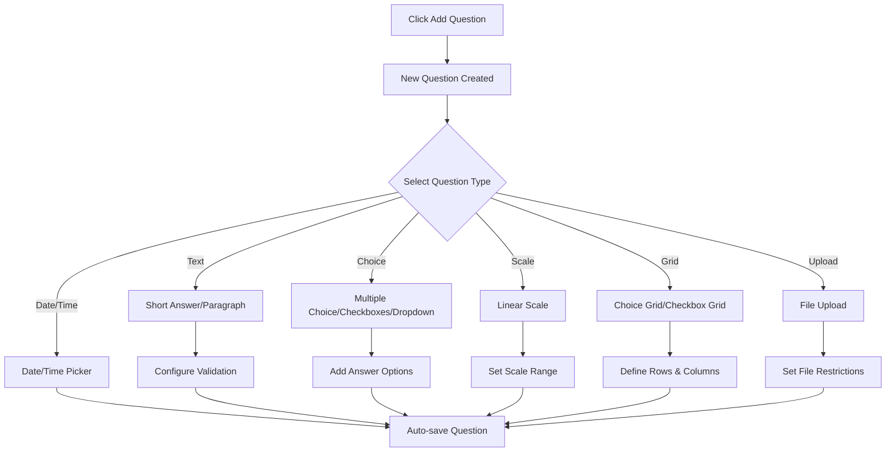
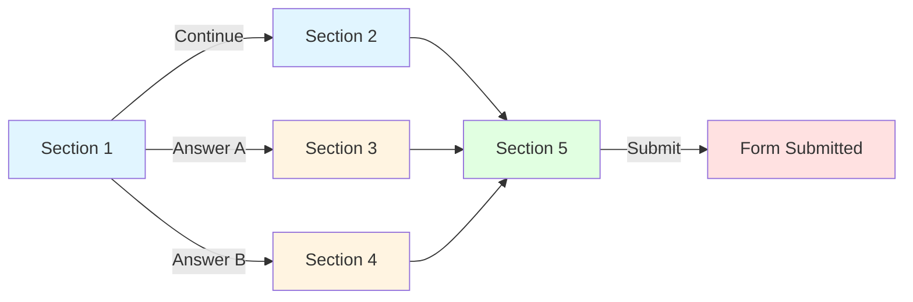
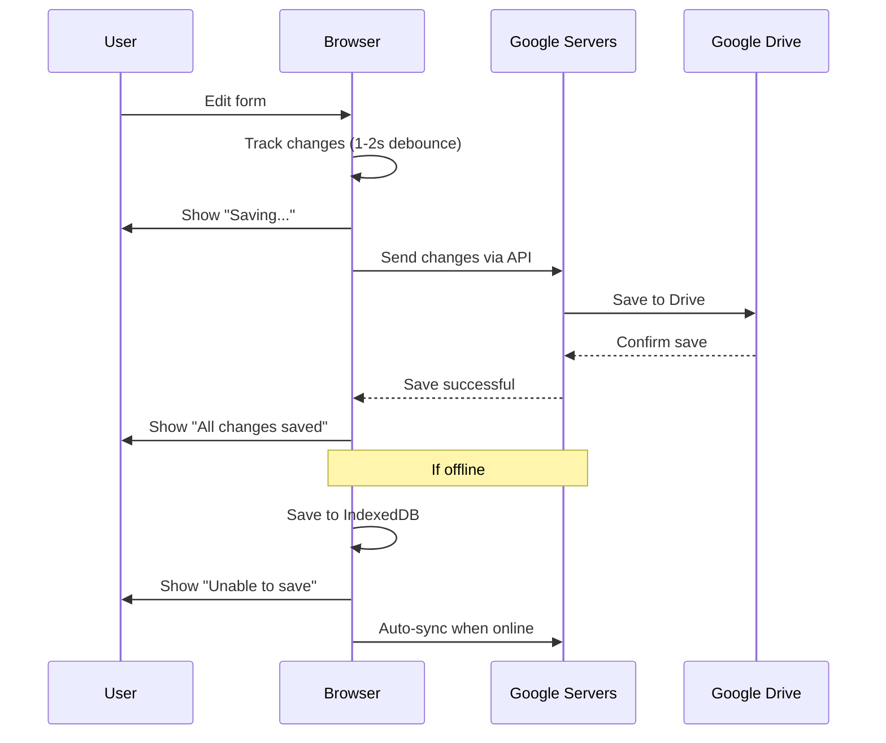
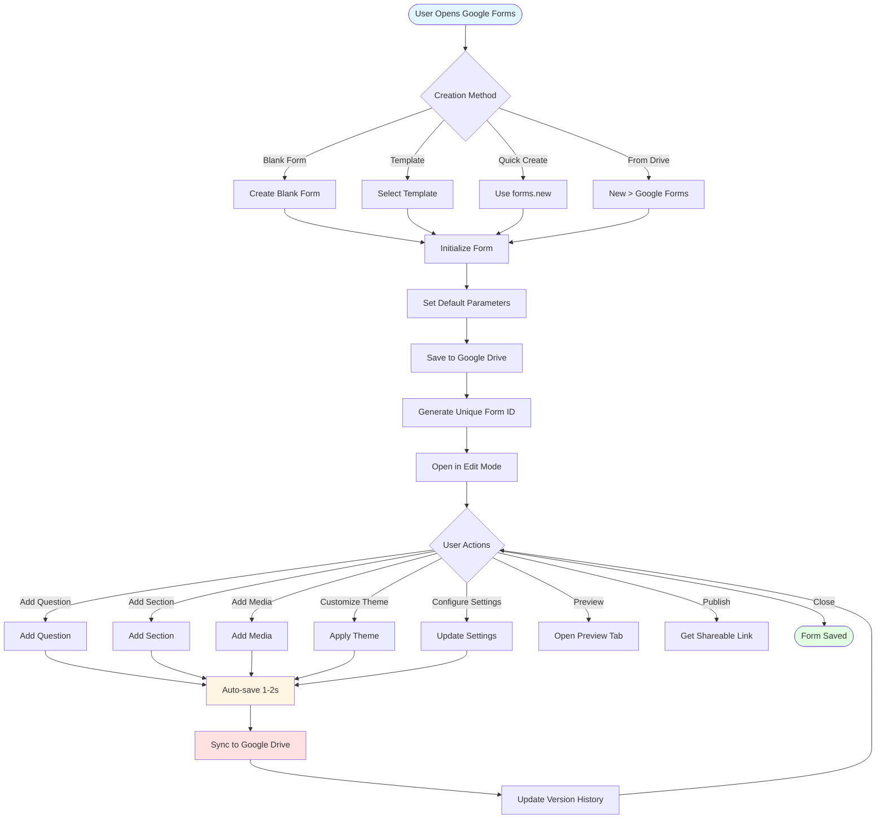
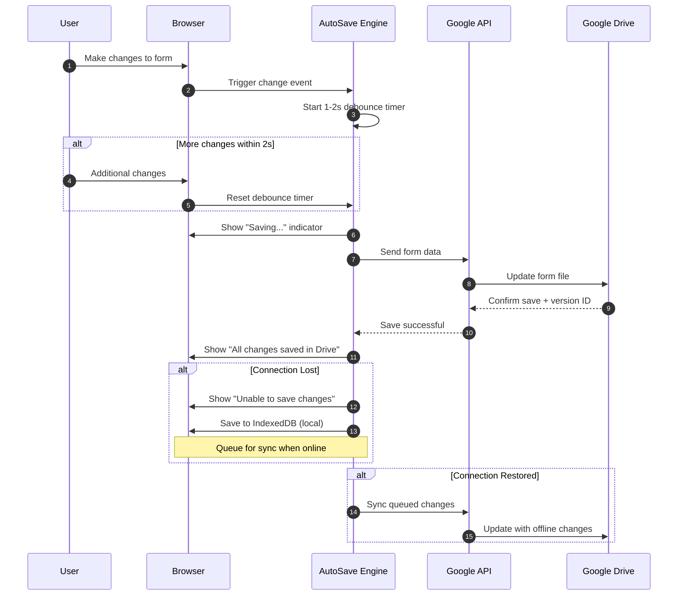
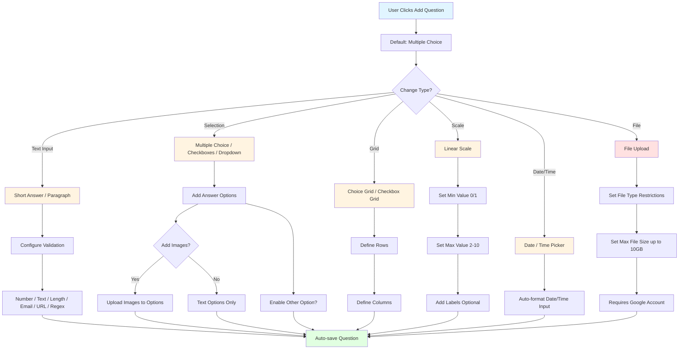

# Form Creation and Editing - Google Forms

> **Module ID**: GFORM-002
> **Version**: 2.0.0
> **Last Updated**: 2025-12-29
> **Dependencies**: [Authentication](./01_auth.md), [Common: Media Upload](../common/media_upload.md)

## Executive Summary

The Form Creation and Editing module is the foundation of Google Forms, enabling users to create interactive surveys, questionnaires, quizzes, and registration forms from scratch or using templates. This module provides an intuitive interface for adding various question types (short answer, multiple choice, scales, file upload), organizing forms into sections and pages, configuring conditional logic, customizing visual appearance with themes and images, and managing drafts with auto-save. The system supports up to 300 content elements per form and up to 75 sections, providing flexibility for creating both simple surveys and complex multi-page questionnaires with branching logic.

---

## Module Characteristics

| Characteristic | Value |
|----------------|-------|
| Primary Function | Form creation and structure management |
| Max Content Elements | 300 per form |
| Max Sections | 75 per form |
| Question Types | 11 types |
| Auto-save Interval | 1-2 seconds |
| Supported Media Formats | JPG, PNG, GIF, BMP, SVG, MP4, MOV, AVI |
| Max Image Size | 10 MB |
| Title Length | 1-250 characters |

---

## User Roles

| Role | Description | Access Level |
|------|-------------|--------------|
| Form Owner | Creator with full rights | Edit, delete, manage access, view responses |
| Form Editor | Collaborator with editing rights | Edit form, view/delete responses (cannot delete form or change owner) |
| Respondent | User filling out the form | Fill and submit form (anonymous or authenticated) |
| Viewer | View-only access | View form structure without editing or submitting |

---

## Functional Requirements

### FR-GFORM-002-001: Create New Form
**Priority**: P0

> As a form creator, I want to create a new blank form or form from template so that I can start collecting information from respondents.

**Preconditions**:
- User is authenticated via Google Account
- User has access to Google Forms
- Browser supports modern web standards

**Main Flow**:
1. User opens Google Forms (forms.google.com)
2. System displays homepage with options:
   - "Create blank form" (+ button or "Blank")
   - "Template Gallery" at top of page
   - List of recent forms (if any)
3. User clicks "Create blank form" (Path A) or "Template Gallery" (Path B)

**Path A - Blank Form**:
4. System creates new blank form with default parameters:
   - Title: "Untitled form" (highlighted for editing)
   - Form description: empty
   - One default question (type: multiple choice)
   - Theme: basic (purple color)
5. System automatically saves form to user's Google Drive default folder
6. System generates unique form ID
7. User sees form editing interface

**Path B - From Template**:
4. System displays template gallery with categories:
   - Personal: Party Invite, RSVP, Event Registration
   - Work: Event Feedback, Job Application, Time Off Request
   - Education: Assessment, Exit Ticket, Worksheet
5. User selects template by clicking preview
6. System creates copy of template with pre-filled:
   - Title and description
   - Set of typical questions for the category
   - Theme styling (if specified in template)
7. User can immediately edit created form
8. Form is saved to Google Drive

**Alternative Flows**:
- Flow A (Create from Google Drive): User can create form directly from Google Drive via "New" > "Google Forms"
- Flow B (Quick creation): User can use direct link forms.new for instant blank form creation
- Flow C (Copy existing form): User opens existing form, clicks menu (three dots) > "Make a copy"

**Acceptance Criteria**:
- [ ] AC-001: Each form receives unique URL in format forms.google.com/d/[FORM_ID]/edit
- [ ] AC-002: New form is private by default (only owner has access)
- [ ] AC-003: Form automatically saved to Google Drive root folder if not specified
- [ ] AC-004: Form name in Google Drive matches form title
- [ ] AC-005: When creating from template, user becomes owner of new copy
- [ ] AC-006: System supports creating unlimited forms per account

**Business Rules**:
| Rule ID | Rule |
|---------|------|
| BR-FORM-001 | Each form receives unique URL: forms.google.com/d/[FORM_ID]/edit |
| BR-FORM-002 | New forms are private by default (owner-only access) |
| BR-FORM-003 | Forms auto-save to Google Drive root unless specified |
| BR-FORM-004 | Drive file name syncs with form title |
| BR-FORM-005 | Template copy creates new ownership for user |
| BR-FORM-006 | No limit on number of forms per account |

**Metrics**:
| Metric | Target | Measurement |
|--------|--------|-------------|
| Form creation time | < 3 seconds | Time from click to editable form |
| Template load time | < 2 seconds | Time to display template gallery |
| Auto-save to Drive | < 5 seconds | Time from creation to Drive storage |

---

### FR-GFORM-002-002: Edit Form Title and Description
**Priority**: P0

> As a form creator, I want to edit the form title, description, and header image so that respondents understand the purpose of my form.

**Preconditions**:
- Form is open in edit mode
- User has editor or owner rights

**Main Flow**:
1. User sees "Untitled form" or current title at top of form
2. User clicks on form title
3. Title text becomes editable (highlighted in blue)
4. User enters new title (max 250 characters)
5. System auto-saves changes 1-2 seconds after input ends
6. System updates file name in Google Drive to match new title
7. User clicks "Form description" field below title
8. User enters form description (max 500 characters)
9. System auto-saves description
10. To add header image:
    - User clicks "Add header" icon (if no image) or existing image
    - System opens image selection dialog with options:
      - Upload: upload from computer (supports drag & drop)
      - By URL: specify image URL
      - Google Drive: select from Google Drive
      - Google Photos: select from Google Photos
      - Google Image Search: find via built-in image search
      - Camera: take photo via webcam
11. User selects source and image
12. System uploads and optimizes image:
    - Recommended aspect ratio: 16:9
    - Max file size: 10 MB
    - Supported formats: JPG, PNG, GIF
13. Image displays in form header
14. User can adjust image alignment (center, left, right)

**Alternative Flows**:
- Flow A (Remove header image): User hovers over image, clicks delete icon (trash)
- Flow B (Replace image): User clicks existing image and selects new one
- Flow C (Resize): System automatically scales image for optimal display
- Flow D (Text too long): If title exceeds limit, system truncates text and shows warning

**Acceptance Criteria**:
- [ ] AC-001: Auto-save occurs every 2 seconds after last change
- [ ] AC-002: Title is mandatory (minimum 1 character)
- [ ] AC-003: Description is optional
- [ ] AC-004: Header image optimized for fast loading (compression, caching)
- [ ] AC-005: Images from Drive and Photos linked, not copied (saves space)
- [ ] AC-006: System shows "Saving..." / "Saved to Drive" indicator
- [ ] AC-007: Change history saved via Google Drive Version History

**Business Rules**:
| Rule ID | Rule |
|---------|------|
| BR-FORM-007 | Auto-save triggers 2 seconds after last modification |
| BR-FORM-008 | Title required (min 1 char, max 250 chars) |
| BR-FORM-009 | Description optional (max 500 chars) |
| BR-FORM-010 | Header images optimized for fast loading |
| BR-FORM-011 | Drive/Photos images linked, not duplicated |
| BR-FORM-012 | Save indicator shows "Saving..." then "Saved to Drive" |
| BR-FORM-013 | Version history maintained via Google Drive |

**Metrics**:
| Metric | Target | Measurement |
|--------|--------|-------------|
| Auto-save latency | < 2 seconds | Time from edit to save |
| Image upload time | < 5 seconds | Time for 10MB image upload |
| Drive sync time | < 3 seconds | Title update to Drive file name |

---

### FR-GFORM-002-003: Add Questions to Form
**Priority**: P0

> As a form creator, I want to add various question types to my form so that I can collect diverse information from respondents.

**Preconditions**:
- Form is open in edit mode
- Number of elements in form does not exceed 300

**Main Flow**:
1. User sees toolbar panel on right with icons:
   - "+" (Add question)
   - "T" (Add title and description)
   - "[]" (Add image)
   - "▶" (Add video)
   - "=" (Add section)
2. User clicks "+" (Add question) icon
3. System adds new question after currently selected element
4. Default question type is "Multiple choice"
5. User can change question type by clicking dropdown to right of question:
   - **Short answer** - short text answer (single line)
   - **Paragraph** - long text answer (multiple lines)
   - **Multiple choice** - select one option from list
   - **Checkboxes** - select multiple options
   - **Dropdown** - dropdown list with single selection
   - **File upload** - file upload by respondent
   - **Linear scale** - linear scale (0/1 to 10)
   - **Multiple choice grid** - grid with single selection
   - **Checkbox grid** - grid with multiple selection
   - **Date** - date selection
   - **Time** - time selection
6. User enters question text in "Question" field
7. Based on question type, user fills additional parameters:

**For Multiple choice / Checkboxes**:
- Enter answer options (Option 1, Option 2, ...)
- Can add "Other" option for custom answer
- Can add image to each option

**For Linear scale**:
- Select start value (0 or 1)
- Select end value (2-10)
- Optionally add labels for min and max values

**For File upload**:
- Select file types (Any, Documents, Spreadsheets, PDFs, Images, Videos, Audio)
- Set max file size (up to 10 GB)
- Set max number of files

**For Grid questions**:
- Enter rows (questions)
- Enter columns (answer options)

8. User can configure additional parameters via icons at bottom of question:
   - Duplicate - duplicate question
   - Delete - delete question
   - Required - make question required (toggle)
   - More options (three dots):
     - Description - add description/hint to question
     - Response validation - configure answer validation
     - Shuffle option order - randomize answer order
     - Go to section based on answer - conditional navigation to section
9. System auto-saves all changes

**Alternative Flows**:
- Flow A (Duplicate question): User clicks Duplicate icon, system creates exact copy
- Flow B (Reorder questions): User drags question by six-dot icon (drag handle)
- Flow C (Add image to question): User clicks image icon next to question text
- Flow D (Element limit reached): System shows "You can add up to 300 pieces of content to your form"

**Acceptance Criteria**:
- [ ] AC-001: Maximum 300 content elements (questions, descriptions, images, videos) per form
- [ ] AC-002: Questions optional by default unless marked Required
- [ ] AC-003: File upload type requires respondent authentication to Google Account
- [ ] AC-004: Answer options in Multiple choice and Checkboxes can be reordered via drag & drop
- [ ] AC-005: "Other" option automatically adds text field for custom answer
- [ ] AC-006: System automatically numbers questions (1, 2, 3...) for navigation
- [ ] AC-007: Unlimited answer options in Multiple choice (practical limit ~1000)

**Business Rules**:
| Rule ID | Rule |
|---------|------|
| BR-FORM-014 | Max 300 content elements per form |
| BR-FORM-015 | Questions optional by default unless Required |
| BR-FORM-016 | File upload requires Google Account authentication |
| BR-FORM-017 | Answer options support drag & drop reordering |
| BR-FORM-018 | "Other" option adds custom text field |
| BR-FORM-019 | Questions auto-numbered for navigation |
| BR-FORM-020 | Unlimited answer options in choice questions |

**Metrics**:
| Metric | Target | Measurement |
|--------|--------|-------------|
| Question addition time | < 1 second | Time from click to editable question |
| Drag & drop response | < 100ms | Reorder operation latency |

---

### FR-GFORM-002-004: Configure Answer Validation
**Priority**: P1

> As a form creator, I want to set validation rules for text questions, numeric fields, and other types so that I ensure data quality from respondents.

**Preconditions**:
- Form contains question that supports validation
- Supported types: Short answer, Paragraph, Checkboxes

**Main Flow**:
1. User selects question for validation configuration
2. User clicks menu (three dots) at bottom of question
3. User selects "Response validation"
4. System displays validation options based on question type:

**For Short answer**:
- **Number**: numeric value validation
  - Greater than, Greater than or equal to, Less than, Less than or equal to
  - Equal to, Not equal to, Between
  - Number, Whole number
- **Text**: text validation
  - Contains, Doesn't contain
  - Email, URL (format validation)
  - Regular expression (matches, contains, doesn't match, doesn't contain)
- **Length**: length validation
  - Maximum character count, Minimum character count

**For Paragraph**:
- **Length**: Maximum character count, Minimum character count
- **Regular expression**: matches, contains, doesn't match, doesn't contain

**For Checkboxes**:
- **Select at least**: minimum number of selected options
- **Select at most**: maximum number of selected options
- **Select exactly**: exact number of selected options

5. User selects validation type from dropdown
6. User specifies validation criteria (e.g., number for comparison, regular expression)
7. User enters custom error message text that respondent will see when rule violated
8. User can add multiple validation rules by clicking "Add another rule"
9. System saves validation settings
10. When form filled by respondent, system validates answer against rules before submission

**Alternative Flows**:
- Flow A (Remove validation): User deletes all validation rules via delete icon
- Flow B (Complex validation): Regular expression used for specific format validation (e.g., phone number)
- Flow C (Multiple rules): Multiple validation rules work with AND logic (all must be satisfied)

**Acceptance Criteria**:
- [ ] AC-001: Validation works client-side before form submission
- [ ] AC-002: Respondent cannot submit form until required questions with validation pass check
- [ ] AC-003: System shows red error message below question when validation violated
- [ ] AC-004: Email validation checks for @ symbol and domain name
- [ ] AC-005: URL validation checks for http:// or https:// format
- [ ] AC-006: Regular expressions use RE2 (Google RE2) syntax

**Business Rules**:
| Rule ID | Rule |
|---------|------|
| BR-FORM-021 | Validation executes client-side before submission |
| BR-FORM-022 | Cannot submit until all required validated questions pass |
| BR-FORM-023 | Red error message displays below question on violation |
| BR-FORM-024 | Email validation requires @ and domain name |
| BR-FORM-025 | URL validation requires http:// or https:// |
| BR-FORM-026 | Regular expressions use Google RE2 syntax |

**Metrics**:
| Metric | Target | Measurement |
|--------|--------|-------------|
| Validation response time | < 100ms | Client-side validation check |
| Error message display | Immediate | Time to show error after input |

---

### FR-GFORM-002-005: Organize Form into Sections
**Priority**: P1

> As a form creator, I want to divide long forms into multiple sections so that I improve readability and navigation, creating multi-page forms.

**Preconditions**:
- Form is open in edit mode
- Number of sections does not exceed 75

**Main Flow**:
1. User clicks "=" (Add section) icon on toolbar panel on right
2. System inserts new section after currently selected element
3. Visually, section separated by horizontal line with "Untitled Section" header
4. User can edit:
   - Section title
   - Section description
5. Each section can contain unlimited questions
6. User can move questions between sections via drag & drop
7. At bottom of each section (except last) navigation options display:
   - "Continue to next section" (default)
   - "Submit form" (if last section before submission)
8. User can configure conditional navigation:
   - Click dropdown "Continue to next section"
   - Select target section or "Submit form"
9. For Multiple choice questions, can configure answer-based navigation:
   - Click menu (three dots) of question
   - Select "Go to section based on answer"
   - For each answer option, select target section

**Alternative Flows**:
- Flow A (Move section): User clicks menu (three dots) of section header > "Move section" > Up/Down
- Flow B (Duplicate section): User selects "Duplicate section" to create copy of entire section with all questions
- Flow C (Delete section): User selects "Delete section", system requests confirmation
- Flow D (Merge sections): User deletes divider between sections
- Flow E (Section limit reached): System shows message about reaching maximum of 75 sections

**Acceptance Criteria**:
- [ ] AC-001: Maximum 75 sections per form
- [ ] AC-002: Each section displays to respondent as separate page
- [ ] AC-003: During form filling, respondent can return to previous sections via "Back" button
- [ ] AC-004: Conditional logic (branching) works only for Multiple choice and Dropdown questions
- [ ] AC-005: Progress bar auto-displays when multiple sections exist (can be disabled in settings)
- [ ] AC-006: Question numbering is continuous across all sections
- [ ] AC-007: Section cannot be empty when filling form (must contain at least one element)

**Business Rules**:
| Rule ID | Rule |
|---------|------|
| BR-FORM-027 | Maximum 75 sections per form |
| BR-FORM-028 | Each section displays as separate page to respondent |
| BR-FORM-029 | Respondents can navigate back to previous sections |
| BR-FORM-030 | Branching logic only for Multiple choice and Dropdown |
| BR-FORM-031 | Progress bar auto-shows for multi-section forms |
| BR-FORM-032 | Question numbering continuous across sections |
| BR-FORM-033 | Sections must contain at least one element when filling |

**Metrics**:
| Metric | Target | Measurement |
|--------|--------|-------------|
| Section navigation time | < 500ms | Time to move between sections |
| Progress bar update | Immediate | Progress calculation after section |

---

### FR-GFORM-002-006: Add Media Elements (Images and Videos)
**Priority**: P1

> As a form creator, I want to insert images and videos between questions so that I enhance visual design and provide context.

**Preconditions**:
- Form is open in edit mode
- Content element limit (300) not reached

**Main Flow (Image)**:
1. User clicks "[]" (Add image) icon on toolbar
2. System inserts image block after current element
3. System opens image selection dialog with options:
   - **Upload**: upload from computer
   - **By URL**: insert via direct link
   - **Google Drive**: select from Drive
   - **Google Photos**: select from Photos
   - **Google Image Search**: search images
   - **Camera**: photo from webcam
4. User selects source and image
5. System uploads image and displays in form
6. User can configure:
   - Image size (small, medium, large)
   - Alignment (left, center, right)
7. User can add description/caption to image
8. Image saves automatically

**Main Flow (Video)**:
1. User clicks "▶" (Add video) icon on toolbar
2. System inserts video block after current element
3. System opens video addition dialog with options:
   - **YouTube**: insert video by URL or via YouTube search
   - **Google Drive**: select video from Drive
4. For YouTube:
   - User enters video URL or searches by keywords
   - System shows preview of found videos
   - User selects video
5. For Google Drive:
   - User selects video file from their Drive
   - Supported formats: MP4, MOV, AVI (up to 100 MB)
6. Video embeds in form with preview
7. User can configure video size (medium, large)
8. User can add description to video

**Alternative Flows**:
- Flow A (Replace image/video): User clicks element and selects "Replace"
- Flow B (Delete element): User clicks menu (three dots) > "Delete"
- Flow C (Reorder): Elements can be moved via drag & drop
- Flow D (Image in answer option): For Multiple choice, can add image to each option

**Acceptance Criteria**:
- [ ] AC-001: Max uploaded image size: 10 MB
- [ ] AC-002: Supported image formats: JPG, PNG, GIF, BMP, SVG
- [ ] AC-003: YouTube videos embed via iframe, not increasing form size
- [ ] AC-004: Drive videos must be publicly accessible or respondents must have access
- [ ] AC-005: Images auto-optimize for different devices (responsive)
- [ ] AC-006: Multiple images and videos can be added throughout form
- [ ] AC-007: Images and videos count toward 300 element limit

**Business Rules**:
| Rule ID | Rule |
|---------|------|
| BR-FORM-034 | Max image upload size: 10 MB |
| BR-FORM-035 | Supported image formats: JPG, PNG, GIF, BMP, SVG |
| BR-FORM-036 | YouTube videos embed via iframe |
| BR-FORM-037 | Drive videos require public access or permissions |
| BR-FORM-038 | Images auto-optimize for responsive display |
| BR-FORM-039 | Multiple media elements allowed throughout form |
| BR-FORM-040 | Media counts toward 300 element limit |

**Metrics**:
| Metric | Target | Measurement |
|--------|--------|-------------|
| Image upload time | < 5 seconds | 10MB image upload |
| Video embed time | < 2 seconds | YouTube video embed |

---

### FR-GFORM-002-007: Customize Form Theme
**Priority**: P1

> As a form creator, I want to change the visual design of my form by selecting color scheme, background image, and font style so that I create branded, attractive forms.

**Preconditions**:
- Form is open in edit mode

**Main Flow**:
1. User clicks palette icon (🎨 Customize theme) in top toolbar
2. System opens customization sidebar with tabs:
   - **Header**: header configuration
   - **Theme color**: theme color selection
   - **Background color**: background color selection
   - **Font style**: font style selection

**Header Tab**:
3. User can:
   - Select header type: Header (image) or Header text (text)
   - If Header (image):
     - Upload image or select from preset gallery
     - Select from preset images (nature, abstract, patterns)
   - If Header text:
     - Enter header text (displays in large font)

**Theme Color Tab**:
4. System shows color palette:
   - Preset colors (purple, blue, teal, green, yellow, orange, red)
   - Custom color: any color via color picker (HEX, RGB)
5. User selects color by clicking it
6. System applies selected color to:
   - Top form panel
   - Submit button
   - Progress indicator
   - Accent elements (focus on input fields)

**Background Color Tab**:
7. User can select:
   - White background (default)
   - Light gray
   - Custom color: any color via color picker

**Font Style Tab**:
8. System offers 4 font styles:
   - **Basic**: Roboto (standard, clean and modern)
   - **Decorative**: Caveat (handwritten, creative)
   - **Formal**: EB Garamond (elegant, traditional)
   - **Playful**: Oswald (bold, expressive)
9. User selects style by clicking it
10. System instantly applies style to entire form
11. User sees preview of changes in real-time
12. User closes customization panel
13. Changes auto-save

**Alternative Flows**:
- Flow A (Reset to default theme): No built-in button, but can manually select purple color and Basic font
- Flow B (Upload custom background image): In Header section can upload own image
- Flow C (Theme responsiveness): Theme auto-adapts to different screen sizes

**Acceptance Criteria**:
- [ ] AC-001: Theme changes don't affect form structure and content
- [ ] AC-002: Theme applies to entire form (cannot configure for individual sections)
- [ ] AC-003: Theme color must provide sufficient contrast for text readability (WCAG compliance)
- [ ] AC-004: Preset header images cached for fast loading
- [ ] AC-005: Fonts loaded from Google Fonts CDN
- [ ] AC-006: Theme saves with form and applies for all respondents

**Business Rules**:
| Rule ID | Rule |
|---------|------|
| BR-FORM-041 | Theme changes don't affect form structure |
| BR-FORM-042 | Theme applies to entire form globally |
| BR-FORM-043 | Theme color must meet WCAG contrast requirements |
| BR-FORM-044 | Preset header images cached for performance |
| BR-FORM-045 | Fonts loaded from Google Fonts CDN |
| BR-FORM-046 | Theme persists with form for all respondents |

**Metrics**:
| Metric | Target | Measurement |
|--------|--------|-------------|
| Theme application time | < 500ms | Time to apply theme changes |
| Font load time | < 1 second | Google Fonts CDN load time |

---

### FR-GFORM-002-008: Duplicate Form (Make a Copy)
**Priority**: P1

> As a form creator, I want to create a full copy of an existing form with all questions, structure, and settings so that I can use it as a template or for modification.

**Preconditions**:
- User has access to form (as owner, editor, or viewer)
- User is authenticated

**Main Flow**:
1. User opens form in edit mode (if has access) or view mode
2. User clicks menu (three dots) in upper right corner
3. User selects "Make a copy" from dropdown menu
4. System opens "Copy document" dialog with parameters:
   - Copy name (default: "Copy of [Original Form Name]")
   - Select folder in Google Drive for saving
   - "Copy responses" option - checkbox
5. User can change copy name
6. User can select different folder by clicking current folder
7. User decides whether to copy responses (if any):
   - If checkbox enabled: all existing responses copied
   - If disabled: form created without responses
8. User clicks "Make a copy" button
9. System creates form copy with following characteristics:
   - All questions and their settings (type, options, validation)
   - All sections and structure
   - All images and videos
   - Theme styling (color, font, header image)
   - Form settings (require login, edit after submit, etc.)
   - Conditional logic navigation between sections
10. System does NOT copy:
    - Access permissions (copy belongs only to copy creator)
    - Form URL (new unique URL generated)
    - Responses (unless option enabled)
11. System saves copy to selected Google Drive folder
12. System opens form copy in edit mode
13. User sees notification "Form copied to [Folder Name]"

**Alternative Flows**:
- Flow A (Copy from Google Drive): User can make copy via Google Drive by right-clicking form file > "Make a copy"
- Flow B (Copy from template): Creating form from template gallery automatically creates copy
- Flow C (Insufficient permissions): If user lacks access to form, "Make a copy" option may be unavailable
- Flow D (Copy via URL): Changing /edit to /copy in form URL opens copy dialog

**Acceptance Criteria**:
- [ ] AC-001: Form copy receives new unique ID
- [ ] AC-002: Copy creator becomes owner of new form
- [ ] AC-003: All images and videos copied by links (not physically duplicated)
- [ ] AC-004: No limit on number of copies of one form
- [ ] AC-005: Version history not copied (copy has own new history)
- [ ] AC-006: No link to original form maintained (changes in original don't reflect in copy)
- [ ] AC-007: Responses copy only if user is owner of original form

**Business Rules**:
| Rule ID | Rule |
|---------|------|
| BR-FORM-047 | Form copy receives new unique ID |
| BR-FORM-048 | Copy creator becomes new form owner |
| BR-FORM-049 | Images/videos copied by links, not duplicated |
| BR-FORM-050 | No limit on copy count |
| BR-FORM-051 | Version history not copied to new form |
| BR-FORM-052 | No link maintained to original form |
| BR-FORM-053 | Responses copy only if owner of original |

**Metrics**:
| Metric | Target | Measurement |
|--------|--------|-------------|
| Copy creation time | < 5 seconds | Time to create form copy |
| Copy with responses time | < 10 seconds | Time including response data |

---

### FR-GFORM-002-009: Delete Form
**Priority**: P1

> As a form owner, I want to delete a form by moving it to Google Drive trash so that I can recover it or delete permanently.

**Preconditions**:
- User is form owner
- Form is open or visible in forms list

**Main Flow**:
1. User opens form menu one of the ways:
   - In edit interface: menu (three dots) > "Move to trash"
   - In Google Drive: right-click form file > "Remove"
   - On Google Forms homepage: menu on form card > "Remove"
2. System shows confirmation message:
   - "Move '[Form Name]' to trash?"
   - "This form will be moved to your Google Drive trash"
3. User clicks "Move to trash"
4. System moves form to Google Drive trash
5. Form disappears from active forms list
6. System shows notification "Moved to trash" with "Undo" option
7. If user clicks "Undo" within few seconds:
   - Form restores to original location
8. If not clicking "Undo":
   - Form remains in Google Drive trash
9. All direct links to form stop working:
   - When attempting to open form URL, respondents see "Form not found"
10. Form responses saved in linked Google Sheets table (if integration configured)

**Restore from Trash**:
11. User opens Google Drive
12. User navigates to "Trash" section
13. User finds form in deleted files list
14. User right-clicks > "Restore"
15. System restores form to original folder
16. Form again accessible via previous URL
17. All settings and responses restored

**Permanent Deletion**:
18. In Google Drive trash, user selects form
19. User clicks "Delete forever" or waits for automatic deletion after 30 days
20. System shows warning: "Delete '[Form Name]' forever?"
21. User confirms deletion
22. Form permanently deleted from system

**Alternative Flows**:
- Flow A (Editor deletion): Form editor cannot delete form, only owner can
- Flow B (Auto deletion): Files in trash auto-delete after 30 days
- Flow C (Linked sheet deletion): If Google Sheets response table deleted, data lost but form continues working
- Flow D (Bulk deletion): Can select multiple forms in Google Drive and delete at once

**Acceptance Criteria**:
- [ ] AC-001: Only owner can delete form (move to trash)
- [ ] AC-002: Editors can delete individual questions or responses, but not form itself
- [ ] AC-003: Deleting form doesn't automatically delete linked response table
- [ ] AC-004: Files in trash stored 30 days, then auto-deleted
- [ ] AC-005: Restore possible anytime within 30 days
- [ ] AC-006: After permanent deletion, recovery impossible
- [ ] AC-007: Deleted form URL becomes invalid immediately

**Business Rules**:
| Rule ID | Rule |
|---------|------|
| BR-FORM-054 | Only owner can delete form (move to trash) |
| BR-FORM-055 | Editors can delete questions/responses, not form |
| BR-FORM-056 | Form deletion doesn't auto-delete response table |
| BR-FORM-057 | Trash files stored 30 days before auto-deletion |
| BR-FORM-058 | Restore available anytime within 30 days |
| BR-FORM-059 | Permanent deletion irreversible |
| BR-FORM-060 | Deleted form URL immediately invalid |

**Metrics**:
| Metric | Target | Measurement |
|--------|--------|-------------|
| Trash operation time | < 2 seconds | Time to move to trash |
| Restore time | < 3 seconds | Time to restore from trash |
| URL invalidation | Immediate | Time until URL becomes invalid |

---

### FR-GFORM-002-010: Auto-save and Draft Management
**Priority**: P0

> As a form creator, I want all my form changes to auto-save in real-time so that I'm protected from data loss and can continue work from any device.

**Preconditions**:
- Form is open in edit mode
- User is connected to internet

**Main Flow**:
1. User opens form in edit mode
2. System loads last saved version of form
3. User makes changes (adds question, edits text, changes theme)
4. System automatically tracks each change
5. 1-2 seconds after last change, system starts auto-save process:
   - "Saving..." indicator appears in upper right corner
   - Data sent to Google servers
   - After successful save, indicator changes to "All changes saved in Drive" with cloud icon
6. Auto-save process repeats after each change
7. User can close form anytime without data loss
8. When reopening form:
   - System loads last saved version
   - All changes available
9. Form syncs between devices:
   - User can start editing on computer
   - Continue on tablet or phone
   - All changes available everywhere

**Alternative Flows**:
- Flow A (Connection loss):
  - If internet disconnects during editing
  - System shows warning "Unable to save changes"
  - Changes saved locally in browser
  - When connection restores, system auto-syncs data

- Flow B (Version conflict):
  - If form edited simultaneously from two devices
  - System uses last change (last-write-wins)
  - Shows notification about possible conflict

- Flow C (View version history):
  - User opens menu > "Version history" or clicks "All changes saved in Drive"
  - System opens sidebar with version history (via Google Drive)
  - User can view previous versions
  - User can restore any version

- Flow D (Named version):
  - In version history, user can click version menu > "Name this version"
  - System allows giving version descriptive name for quick search

**Acceptance Criteria**:
- [ ] AC-001: Auto-save occurs every 1-2 seconds after last change
- [ ] AC-002: All form versions saved in Google Drive history
- [ ] AC-003: Version history stored indefinitely (within Google Drive quota)
- [ ] AC-004: Any version can be restored from history
- [ ] AC-005: System doesn't create separate "drafts" - all changes save to main form
- [ ] AC-006: Simultaneous editing by multiple users supported
- [ ] AC-007: Changes visible in real-time to other editors (collaborative editing)
- [ ] AC-008: Local changes saved in browser IndexedDB when offline
- [ ] AC-009: No "Save" button - everything auto-saves

**Business Rules**:
| Rule ID | Rule |
|---------|------|
| BR-FORM-061 | Auto-save triggers 1-2 seconds after last change |
| BR-FORM-062 | All form versions saved in Google Drive history |
| BR-FORM-063 | Version history stored indefinitely (Drive quota) |
| BR-FORM-064 | Any version can be restored from history |
| BR-FORM-065 | No separate drafts - changes save to main form |
| BR-FORM-066 | Simultaneous multi-user editing supported |
| BR-FORM-067 | Changes visible in real-time to other editors |
| BR-FORM-068 | Local changes saved in IndexedDB when offline |
| BR-FORM-069 | No manual "Save" button - all auto-saves |

**Metrics**:
| Metric | Target | Measurement |
|--------|--------|-------------|
| Auto-save latency | < 2 seconds | Time from change to save |
| Sync time between devices | < 5 seconds | Cross-device synchronization |
| Offline storage capacity | 50 MB | IndexedDB local storage limit |

---

### FR-GFORM-002-011: Add Title and Description Blocks
**Priority**: P2

> As a form creator, I want to add text blocks with title and description to structure my form and provide additional context without creating questions.

**Preconditions**:
- Form is open in edit mode
- Element limit (300) not reached

**Main Flow**:
1. User clicks "Tt" (Add title and description) icon on toolbar panel on right
2. System inserts text block after currently selected element
3. Block contains two fields:
   - "Title" - block title (large font)
   - "Description" - block description (regular text)
4. User clicks "Title" field
5. User enters title (e.g., "Personal Information", "Section 1: Background")
6. User clicks "Description" field
7. User enters descriptive text:
   - Instructions for respondents
   - Explanations for question group
   - Additional context
   - Thanks or greetings
8. System auto-saves entered text
9. User can format description text:
   - Bold, italic, underline (via text selection)
   - Bulleted and numbered lists
   - Links (URL insertion)
10. Block displays to respondents as informational element without input capability

**Additional Capabilities**:
11. User can reorder blocks via drag & drop (six-dot icon)
12. User can duplicate block via menu (three dots) > "Duplicate"
13. User can delete block via menu > "Delete"
14. Multiple text blocks can be added throughout form

**Alternative Flows**:
- Flow A (Title only): Can leave description field empty, using only title
- Flow B (Description only): Can leave title empty, using only description
- Flow C (Long description): No limit on description text length (practical limit ~5000 characters)
- Flow D (Formatting doesn't work): Advanced formatting (color, font size) not supported, only basic

**Acceptance Criteria**:
- [ ] AC-001: Text blocks are not questions and don't require answers
- [ ] AC-002: Blocks count toward 300 element limit
- [ ] AC-003: Unlimited text blocks can be added
- [ ] AC-004: Text blocks support basic Rich Text formatting
- [ ] AC-005: Links in description automatically become clickable for respondents
- [ ] AC-006: Text blocks useful for dividing large forms into logical groups
- [ ] AC-007: Recommended to use instead of empty sections for instructions

**Business Rules**:
| Rule ID | Rule |
|---------|------|
| BR-FORM-070 | Text blocks are not questions, no answer required |
| BR-FORM-071 | Blocks count toward 300 element limit |
| BR-FORM-072 | Unlimited text blocks allowed |
| BR-FORM-073 | Blocks support basic Rich Text formatting |
| BR-FORM-074 | Links auto-clickable for respondents |
| BR-FORM-075 | Blocks useful for logical grouping |
| BR-FORM-076 | Preferred over empty sections for instructions |

**Metrics**:
| Metric | Target | Measurement |
|--------|--------|-------------|
| Block addition time | < 1 second | Time to add text block |
| Text rendering time | < 100ms | Rich text formatting render |

---

### FR-GFORM-002-012: Configure Form Settings
**Priority**: P0

> As a form creator, I want to configure general form parameters including authentication requirements, response limits, edit after submit, progress bar, and other settings so that I control form behavior.

**Preconditions**:
- Form is open in edit mode

**Main Flow**:
1. User clicks gear icon (⚙️ Settings) in top toolbar
2. System opens "Settings" modal window with three tabs:
   - General
   - Presentation
   - Defaults

**General Tab**:
3. User sees settings:
   - **Collect email addresses** - collect respondent email addresses
     - Requires sign in to Google Account
     - Checkbox option: Verified (collect only verified addresses)
   - **Limit to 1 response** - limit to one response per user
     - Requires Google Account login
   - **Edit after submit** - allow editing after submission
     - Respondent can return and modify their answers
   - **See summary charts and text responses** - show summary statistics to respondents after submission

**Presentation Tab**:
4. User sees display settings:
   - **Show progress bar** - show progress bar
     - Displays only for multi-page forms (with sections)
   - **Shuffle question order** - randomize question order
     - Each respondent sees questions in random order
     - Useful for tests and surveys
   - **Show link to submit another response** - show link to submit another response after completion
   - **Confirmation message** - confirmation message text
     - Default: "Your response has been recorded"
     - Can be customized (up to 500 characters)

**Defaults Tab**:
5. User sees default settings:
   - **Make questions required by default** - make all new questions required by default
     - Can be disabled for individual questions
   - **Collect respondents' email** - auto-collect email on login

6. User enables/disables desired options via toggle switches
7. User edits confirmation message text (if needed)
8. User clicks "Save" or simply closes window (changes auto-save)
9. System applies settings to form
10. Settings take effect immediately for new respondents

**Alternative Flows**:
- Flow A (Require login for File upload): If form has File upload question, "Limit to 1 response" and email collection automatically require login
- Flow B (Disable progress bar): If form consists of one section, progress bar doesn't display
- Flow C (Custom confirmation message): Can add links and formatting to message

**Acceptance Criteria**:
- [ ] AC-001: Email collection requires respondent to log in to Google Account
- [ ] AC-002: "Limit to 1 response" works via cookies and IP, requires login for accuracy
- [ ] AC-003: "Edit after submit" creates unique link for each respondent for editing
- [ ] AC-004: Progress bar shows percentage of completed sections (not questions)
- [ ] AC-005: "Shuffle question order" doesn't apply to sections, only questions within section
- [ ] AC-006: Settings affect all future respondents but don't change submitted responses
- [ ] AC-007: "See summary charts" shows aggregated statistics only for Multiple choice, Checkboxes, Linear scale questions
- [ ] AC-008: Confirmation message supports basic formatting and links

**Business Rules**:
| Rule ID | Rule |
|---------|------|
| BR-FORM-077 | Email collection requires Google Account login |
| BR-FORM-078 | "Limit to 1 response" via cookies/IP, requires login for accuracy |
| BR-FORM-079 | "Edit after submit" creates unique edit link per respondent |
| BR-FORM-080 | Progress bar shows section completion percentage |
| BR-FORM-081 | "Shuffle question order" applies within sections only |
| BR-FORM-082 | Settings affect future respondents, not existing responses |
| BR-FORM-083 | Summary charts only for choice/scale question types |
| BR-FORM-084 | Confirmation message supports basic formatting/links |

**Metrics**:
| Metric | Target | Measurement |
|--------|--------|-------------|
| Settings save time | < 1 second | Time to apply settings |
| Progress bar calculation | < 100ms | Real-time progress update |

---

### FR-GFORM-002-013: Preview Form
**Priority**: P1

> As a form creator, I want to preview how my form will look to respondents on various devices (computer, tablet, phone) before publishing.

**Preconditions**:
- Form is open in edit mode

**Main Flow**:
1. User clicks eye icon (👁️ Preview) in top toolbar
2. System opens form in new browser tab in view mode
3. URL in preview mode is: forms.google.com/d/[FORM_ID]/viewform
4. User sees form as respondents will see it:
   - Form title and description
   - Header image (if any)
   - All questions with input fields
   - Applied theme styling
   - "Submit" button at bottom of form
5. User can:
   - Scroll form to view all questions
   - Try filling fields (test input)
   - Navigate between sections (if multi-page form)
   - See validation and error messages
6. User CANNOT submit form in preview mode:
   - "Submit" button disabled or shows warning
7. For mobile device preview:
   - User can use browser developer tools (F12) to emulate devices
   - Or resize browser window
   - System auto-adapts display (responsive design)
8. To exit preview, user closes tab

**Alternative Flows**:
- Flow A (Test submission): For real form functionality test, need to open form via public link and submit test response
- Flow B (Preview on real device): Can send link to mobile device for testing
- Flow C (Preview with changes): When changing form in edit mode, need to refresh preview tab to display changes

**Acceptance Criteria**:
- [ ] AC-001: Preview mode doesn't record responses
- [ ] AC-002: Form in preview displays with all settings applied (theme, validation, conditional logic)
- [ ] AC-003: Preview URL (/viewform) identical to public form URL
- [ ] AC-004: Form auto-adapts to screen size (mobile-first design)
- [ ] AC-005: On mobile devices, questions display in single column
- [ ] AC-006: Images scale for optimal viewing on different screens

**Business Rules**:
| Rule ID | Rule |
|---------|------|
| BR-FORM-085 | Preview mode doesn't record responses |
| BR-FORM-086 | Preview displays with all settings applied |
| BR-FORM-087 | Preview URL (/viewform) equals public URL |
| BR-FORM-088 | Form auto-adapts to screen size (responsive) |
| BR-FORM-089 | Mobile displays questions in single column |
| BR-FORM-090 | Images auto-scale for screen optimization |

**Metrics**:
| Metric | Target | Measurement |
|--------|--------|-------------|
| Preview load time | < 2 seconds | Time to open preview |
| Responsive adaptation | < 100ms | Time to adapt to screen size |

---

### FR-GFORM-002-014: Import Questions from Another Form
**Priority**: P2

> As a form creator, I want to import questions from an existing form into current one so that I speed up creation and reuse content.

**Preconditions**:
- Form is open in edit mode
- User has access to other forms for import

**Main Flow**:
1. User clicks menu (three dots) of any question in form
2. In dropdown menu, user doesn't see direct import option
3. **Alternative method**: Using form duplication function
4. User opens source form from which to copy questions
5. User selects desired questions
6. For each question:
   - Clicks duplicate icon (Duplicate)
   - Or uses hotkeys Ctrl+C (copy)
7. User switches to target form
8. User clicks insertion location
9. User uses Ctrl+V (paste)
10. System inserts copied question with all settings:
    - Question type
    - Question text and description
    - Answer options
    - Validation
    - Settings (required, conditional navigation)
    - Images (links to them)
11. Question becomes part of current form
12. Process can be repeated to import multiple questions

**Alternative Flows**:
- Flow A (Copy section): Can copy entire section using section menu > "Duplicate section"
- Flow B (Import via template): Creating form from template automatically imports all template questions
- Flow C (Bulk copying): No built-in mechanism to select and copy multiple questions simultaneously
- Flow D (Copy between different accounts): If source form belongs to another account, need access permissions

**Acceptance Criteria**:
- [ ] AC-001: Question copying works between forms of same account or with shared access
- [ ] AC-002: Images copied by links, not physically duplicated
- [ ] AC-003: Conditional logic navigation may require adjustment in new form
- [ ] AC-004: No native "Import questions" function via menu
- [ ] AC-005: Can copy questions between forms using standard copy operations (Ctrl+C/Ctrl+V)
- [ ] AC-006: Google Forms doesn't support importing questions from files (CSV, Excel)

**Business Rules**:
| Rule ID | Rule |
|---------|------|
| BR-FORM-091 | Question copying works with shared access |
| BR-FORM-092 | Images copied by links, not duplicated |
| BR-FORM-093 | Conditional logic may need adjustment |
| BR-FORM-094 | No native "Import questions" menu function |
| BR-FORM-095 | Can copy questions via standard Ctrl+C/Ctrl+V |
| BR-FORM-096 | No file import support (CSV, Excel) |

**Metrics**:
| Metric | Target | Measurement |
|--------|--------|-------------|
| Question copy time | < 1 second | Time to copy and paste question |
| Section copy time | < 3 seconds | Time to duplicate entire section |

---

## Data Entities

### Form
- **form_id** - unique form identifier
- **title** - form title (1-250 characters)
- **description** - form description (up to 500 characters)
- **owner_id** - owner (creator) ID
- **created_at** - creation date and time
- **updated_at** - last modification date
- **drive_file_id** - file ID in Google Drive
- **theme** - theme styling settings (JSON)
  - color: theme color HEX code
  - background_color: background HEX code
  - font_style: Basic/Decorative/Formal/Playful
  - header_image_url: header image link
  - header_type: image/text
- **settings** - form settings (JSON)
  - collect_email: boolean
  - limit_one_response: boolean
  - edit_after_submit: boolean
  - show_progress_bar: boolean
  - shuffle_questions: boolean
  - show_summary: boolean
  - confirmation_message: string
- **version** - version number for change history
- **public_url** - public URL for filling
- **edit_url** - URL for editing
- **status** - status (draft/published/archived)

### Form Section
- **section_id** - unique section identifier
- **form_id** - form ID to which section belongs
- **title** - section title
- **description** - section description
- **order** - section order number (for sorting)
- **navigation_type** - navigation type (continue_next/go_to_section/submit)
- **target_section_id** - target section ID for conditional navigation

### Question
- **question_id** - unique question identifier
- **form_id** - form ID
- **section_id** - section ID (if any)
- **type** - question type (short_answer, paragraph, multiple_choice, checkboxes, dropdown, file_upload, linear_scale, multiple_choice_grid, checkbox_grid, date, time)
- **title** - question text
- **description** - question description/hint
- **order** - order number in form
- **required** - answer required (boolean)
- **options** - answer options (JSON array)
  - For multiple_choice/checkboxes: [{text, image_url, go_to_section_id}]
  - For grid: {rows: [], columns: []}
  - For linear_scale: {min, max, min_label, max_label}
- **validation** - validation rules (JSON)
  - type: number/text/length/email/url/regex
  - condition: greater_than/contains/min_length/etc
  - value: threshold value
  - error_message: error message text
- **allow_other** - allow "Other" option (boolean)
- **shuffle_options** - shuffle answer options (boolean)
- **image_url** - question image link

### Media Element
- **media_id** - unique identifier
- **form_id** - form ID
- **section_id** - section ID (if any)
- **type** - type (image/video)
- **order** - order number
- **url** - media file link
- **description** - description/caption
- **alignment** - alignment (left/center/right)
- **size** - size (small/medium/large)

### Text Block
- **text_block_id** - unique identifier
- **form_id** - form ID
- **section_id** - section ID (if any)
- **order** - order number
- **title** - block title
- **description** - description text (Rich Text)

### Version History
- **version_id** - unique version identifier
- **form_id** - form ID
- **created_at** - version creation date
- **created_by** - user ID who created version
- **version_name** - named version (if assigned)
- **snapshot** - form state snapshot (JSON)

---

## States and Statuses

### Form Statuses
- **draft** - draft, form created but not published
- **published** - form published and accessible via link
- **archived** - form archived (not accepting new responses)
- **trashed** - form in Google Drive trash

### Question Types
- **short_answer** - short text answer
- **paragraph** - long text answer
- **multiple_choice** - single selection
- **checkboxes** - multiple selection
- **dropdown** - dropdown list
- **file_upload** - file upload
- **linear_scale** - linear scale
- **multiple_choice_grid** - grid with single selection
- **checkbox_grid** - grid with multiple selection
- **date** - date
- **time** - time

### Navigation Types Between Sections
- **continue_next** - continue to next section
- **go_to_section** - go to specific section
- **submit_form** - submit form
- **based_on_answer** - navigation based on answer (conditional logic)

### Font Styles
- **Basic** - Roboto (standard)
- **Decorative** - Caveat (decorative)
- **Formal** - EB Garamond (formal)
- **Playful** - Oswald (playful)

---

## Limitations and Constraints

### Form Content Limits
- **Max content elements**: 300 (questions + images + videos + text blocks)
- **Max sections**: 75
- **Form title length**: up to 250 characters
- **Form description length**: up to 500 characters
- **Question text length**: practical limit ~5000 characters
- **Number of answer options**: unlimited (practical limit ~1000)
- **Answer option length**: up to 1000 characters

### Media File Limits
- **Max image size**: 10 MB
- **Supported image formats**: JPG, PNG, GIF, BMP, SVG
- **Recommended header aspect ratio**: 16:9
- **Max video size from Google Drive**: 100 MB
- **YouTube videos**: no limits (embedding via link)

### File Upload Question Limits
- **Max single file size**: 10 GB
- **Max number of files**: 10 per question
- **Supported types**: any files, or restriction by categories (documents, images, videos, audio)
- **Storage**: files saved to form owner's Google Drive

### Collaboration Limits
- **Simultaneous editors**: practically unlimited (50+)
- **Number of collaborators**: unlimited
- **Sync delay**: 1-2 seconds

### Validation Limits
- **Validation rules per question**: practically unlimited
- **Regular expression length**: up to 1000 characters
- **Error message length**: up to 500 characters

---

## Integration with Other Modules

### Module "Authentication and Account Management"
- Form creation requires authentication via Google Account
- Forms linked to owner (Google Account ID)
- Form privacy settings controlled via Google Account
- **Reference**: [Authentication Module](./01_auth.md)

### Module "Collaboration and Access Management"
- Forms can be shared with other users (view, edit)
- Permission management via Google Drive sharing
- Real-time collaborative editing
- **Reference**: [Collaboration Module](./05_collaboration.md)

### Module "Google Drive Integration"
- Each form automatically saved as file in Google Drive
- File name synced with form title
- Version history stored via Google Drive Version History
- Form deletion = move to Drive trash (30 days until permanent deletion)
- Files uploaded by respondents via File Upload saved to special folder in owner's Drive
- **Reference**: [Common: Media Upload](../common/media_upload.md)

### Module "Response Collection and Processing"
- Created form accessible for filling via public URL
- Form settings affect response collection process (limits, validation)
- Conditional logic determines respondent's route through form
- **Reference**: [Response Collection Module](./07_response_collection.md)

### Module "Response Analysis and Visualization"
- Question structure determines response visualization format
- Question types (Multiple choice, Linear scale) automatically generate charts
- "Show summary charts" setting allows respondents to see statistics
- **Reference**: [Analytics Module](./08_analytics_reports.md)

### Module "Google Sheets Integration"
- When creating Google Sheets link, form structure determines table structure
- Each question becomes column in table
- Form structure changes affect new responses in table
- **Reference**: [Integrations Module](./10_integrations_addons.md)

### Module "Settings and Administration"
- Form inherits Google Account settings (language, timezone)
- Owner can manage all form aspects
- Editors have limited rights (cannot delete form)
- **Reference**: [Settings Module](./12_settings_security.md)

---

## System Diagrams

### Form Creation Flow

### Auto-save Mechanism

### Question Type Selection

---

## Sources

**Official Google Documentation**:
- [Edit your form - Google Docs Editors Help](https://support.google.com/docs/answer/2839737?hl=en)
- [Choose a type of question for your form - Google Docs Editors Help](https://support.google.com/docs/answer/7322334?hl=en)
- [Create your first form in Google Forms - Google Workspace Learning Center](https://support.google.com/a/users/answer/9303071?hl=en)

**Section and Structure Guides**:
- [How to Create Form Sections & Redirect in Google Forms](https://formester.com/blog/how-create-form-sections-in-google-forms/)
- [How to make different sections in Google Forms: A step-by-step guide](https://www.jotform.com/google-forms/how-to-make-different-sections-in-google-forms/)
- [How to Add Sections to Your Google Forms](https://activitymessenger.com/blog/how-to-add-sections-to-your-google-forms/)
- [How to Make Multiple Pages in Google Forms](https://www.geeksforgeeks.org/websites-apps/how-to-make-multiple-pages-on-google-forms-latest-update/)

**Customization and Themes**:
- [How to Use Google Forms Themes to Make Your Surveys Pop in 2025?](https://extendedforms.io/blog/google-forms-themes)
- [How to customize Google Forms in 2025](https://www.jotform.com/google-forms/how-to-customize-google-forms/)
- [A full guide to the Google Forms Themes (Tips & more)](https://forms.app/en/blog/how-to-change-google-forms-themes)
- [How to Customize the Theme of a Google Form](https://supademo.com/blog/guides/how-to-customize-the-theme-of-a-google-form/)

**Conditional Logic and Branching**:
- [How to Create a Google Form with Branching Logic](https://www.howtogeek.com/437542/how-to-create-a-google-form-with-branching-logic/)
- [How to set conditional questions in Google Forms](https://paperform.co/google-forms/conditional-questions/)
- [Using Skip Logic and Conditional Questions in Google Forms](https://form-publisher.com/blog/conditional-questioning-in-google-forms/)
- [How to Use Conditional Logic in Google Forms in 2025](https://www.geeky-gadgets.com/how-to-create-google-forms-with-conditional-logic-2025/)

**Duplication and Copying**:
- [How to Make a Copy of a Google Form (Guide 2026)](https://www.involve.me/blog/how-to-make-a-copy-of-a-google-form)
- [How to Duplicate Google Forms (3 Ways) - 2025](https://blog.supatool.io/article/how-to-duplicate-google-forms)
- [How to make a copy of a Google Form: 4 different ways](https://www.jotform.com/google-forms/how-to-copy-a-google-form/)

**Auto-save and Drafts**:
- [Auto-save your response progress on a Google Form](https://support.google.com/docs/answer/10952360?hl=en-GB)

**Form Editing**:
- [How to Edit a Google Form (Step-by-Step Guide)](https://www.involve.me/blog/how-to-edit-a-google-form)
- [How to edit a Google Form](https://www.jotform.com/google-forms/how-to-edit-a-google-form/)

**Question Types**:
- [The Ultimate Guide for Google Forms Question Types](https://nerdy-form.com/blog/google-forms-question-types)
- [Google Forms Question Types - How to GApps](https://howtogapps.com/google-forms-question-types/)

**Templates**:
- [Top 5 Google Forms Templates in 2025 (Custom & Free!)](https://formester.com/blog/best-google-forms-templates/)

---

**Note**: This specification describes business logic and functional requirements for the Google Forms creation and editing module. The specification does not contain technical implementation details, system architecture, or API endpoints.
